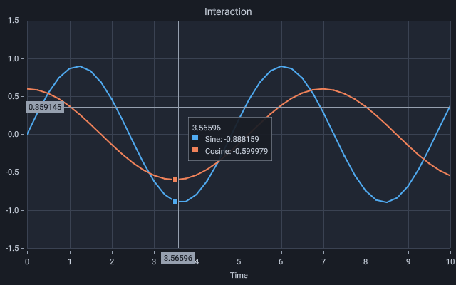

<h1>
  <picture>
    <source media="(prefers-color-scheme: dark)" srcset="shared/logo/tachyon-charts-lockup-dark-transparent.svg">
    
  </picture>
</h1>

**Tachyon Charts for JavaScript**

Fast charts for the browser, drawn on the GPU with WebGPU, with fallbacks to WebGL 2 and Canvas 2D. Made for large
data: millions of points in real time and files larger than memory.

**Status:** early development. Charts with lines, scatter markers, areas, bands and bars draw on WebGPU, with
axes, time axes, layout and text as in the .NET version.
There is no release yet and the API will change. The packages will appear on npm under
`@tachyon-charts/…`.

## A first chart


```ts
import { ChartSurface, DataSource, LineSeries, NumericAxis, TextEngine } from '@tachyon-charts/core';
import { createWebGpuDevice } from '@tachyon-charts/render-webgpu';

const device = await createWebGpuDevice();
const x = new NumericAxis('x', 'bottom');
const y = new NumericAxis('y', 'left');
const chart = new ChartSurface([x], [{ axes: [y] }], new TextEngine(robotoFontData));
chart.addSeries(new LineSeries(source, x, y)); // source: a DataSource with append(x, y)

const target = device.createSurfaceTarget({ kind: 'canvas', canvas }, { width, height }, devicePixelRatio);
chart.render(device, target);
```

A line of a million points draws the extremes of each pixel column, so every peak stays visible; the pyramid behind it
builds in a worker when the data lies in a `SharedArrayBuffer`. Besides `LineSeries` there are `ScatterSeries`,
`AreaSeries`, `StackedAreaSeries`, `BandSeries` and `BarSeries`. The complete example is in `examples/basic`.

The same chart in the words of the .NET version:

```ts
const { surface } = new ChartBuilder()
  .title('Sensors')
  .xAxis((a) => a.title('Time'))
  .yAxis((a) => a.autoRange())
  .addLine(source, (l) => l.stroke(rgba(240, 130, 90)).thickness(2))
  .build(engine);
```

Axes are numeric, logarithmic, categories or time in any time zone, with daylight saving and labels in English or
German. The public API of every package is listed in `docs/api`.

## Web component


`<tachyon-chart>` works in every web application, with any framework or none. It follows its size and the pixel ratio
of the screen, takes zoom, pan, crosshair and keys, follows light and dark of the system, and frees its GPU resources
when it leaves the page:

```html
<tachyon-chart id="chart" style="height: 400px"></tachyon-chart>
<script type="module">
  import { ChartBuilder, DataSource } from '@tachyon-charts/core';
  import { defineTachyonChart } from '@tachyon-charts/element';

  defineTachyonChart();
  const data = new DataSource();
  data.append([0, 1, 2, 3], [1, 3, 2, 4]);
  document.querySelector('#chart').chart = new ChartBuilder().xAxis().yAxis((a) => a.autoRange()).addLine(data);
</script>
```

Attributes: `theme` (`auto`, a built-in name such as `light` or `neon`, or `none`) and `interactive="false"`. Events:
`tachyon-ready`, `tachyon-tooltip` with the point under the pointer, `tachyon-error`. Examples: `examples/web-component`
(a Vite application) and `examples/no-bundler` (an import map, no build step).

Charts draw in a render worker: the element hands its canvas to the worker as `OffscreenCanvas`, and the WebGPU
device there uploads the data, encodes and presents the frames, while the page keeps the chart, its layout and the
input. Where a browser cannot hand a canvas to a worker, charts draw on the main thread; both look the same to the
pixel. `TachyonChartElement.renderInWorker = false` before the first chart chooses the main thread, and
`chart.renderThread` tells where a chart draws. Without the element, `createWebGpuWorkerDevice()` of
`@tachyon-charts/render-webgpu` gives the same device to a chart of your own.

## Interaction



The wheel zooms around the pointer, dragging pans, Ctrl and drag zooms into a rectangle, dragging an axis moves it and
Shift scales it, arrows and + and − move and zoom, Home or a double click shows all data again, Ctrl+Z and Ctrl+Y undo
and redo, and two fingers pan and pinch. A crosshair shows the values of the axes and of all series, a tooltip reports
the nearest point. The interactions are modifiers in a pipeline, the same as in the .NET version, and
`bindChartInput` from `@tachyon-charts/element` feeds them the pointer, wheel and key events of a canvas:

```ts
const pipeline = new ModifierPipeline();
pipeline.interaction = new ChartInteraction(chart);
pipeline.add(new ZoomPanModifier());
pipeline.add(new RubberBandZoomModifier());
pipeline.add(new CrosshairModifier());
bindChartInput(canvas, pipeline);
```

## Themes


Charts take the themes of the .NET version, from the same JSON files: Tachyon Dark and Light, High Contrast, Neon,
Paper, Instrument and Signal, or a theme of your own that changes some values of one of them. `@tachyon-charts/element`
adds light or dark after the preference of the system and themes from CSS custom properties:

```ts
chart.theme = findBuiltInTheme('light');
chart.theme = resolveTheme({ name: 'Mine', base: 'dark', grid: { major: '#FF000080' } });
watchPreferredTheme((theme) => (chart.theme = theme));
chart.theme = themeFromCss(container); // --tachyon-background, --tachyon-grid-major, --tachyon-palette …
```

A chart described with the fluent API brings its own theme with `.theme(findBuiltInTheme('instrument'))`;
`<tachyon-chart>` uses it unless its `theme` attribute names another one.

## Showroom


`examples/showroom` shows every finished feature on a page of its own: lines, splines, step lines, a million points,
scatter, areas, bands, bars, logarithmic, category and time axes, axes in the origin and the themes. A theme and the
language of the axes can be chosen at the top for all pages. Every new feature brings its page.

## Packages

| Package | Content |
|---|---|
| `@tachyon-charts/core` | Charts, axes, data, interaction, layout and themes |
| `@tachyon-charts/render-webgpu` | WebGPU backend |
| `@tachyon-charts/render-webgl` | WebGL 2 fallback |
| `@tachyon-charts/render-canvas` | Canvas 2D fallback and export |
| `@tachyon-charts/element` | The web component `<tachyon-chart>` |
| `@tachyon-charts/large-data` | Column files, pyramids, OPFS, HTTP range requests, workers |
| `@tachyon-charts/3d` | 3D charts |
| `@tachyon-charts/geo` | Maps |
| `@tachyon-charts/medical` | DICOM and NIfTI images |
| `@tachyon-charts/configurator` | The configurator as a web app |

## Documentation

- [File formats](docs/guide/file-formats.md): column files, pyramids, point tiles, rasters and maps

## Build from source

Requires Node.js 22.12 or later. pnpm comes with Node.js through Corepack.

```bash
corepack pnpm install
corepack pnpm build
```

## License

Apache License 2.0, see [LICENSE](LICENSE) and [NOTICE](NOTICE).
