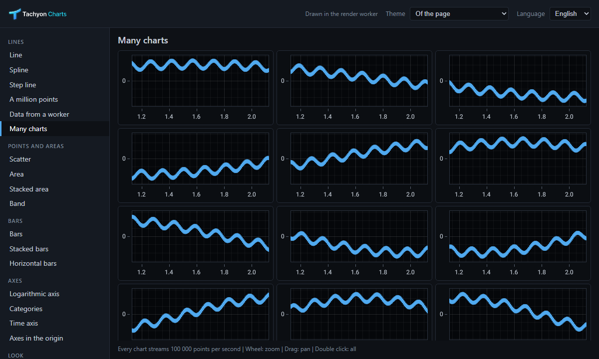
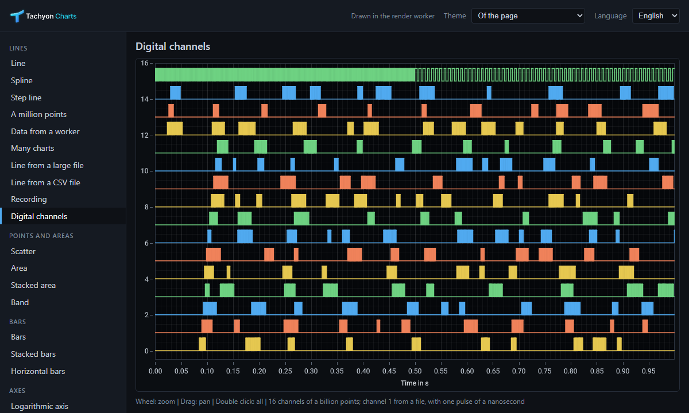
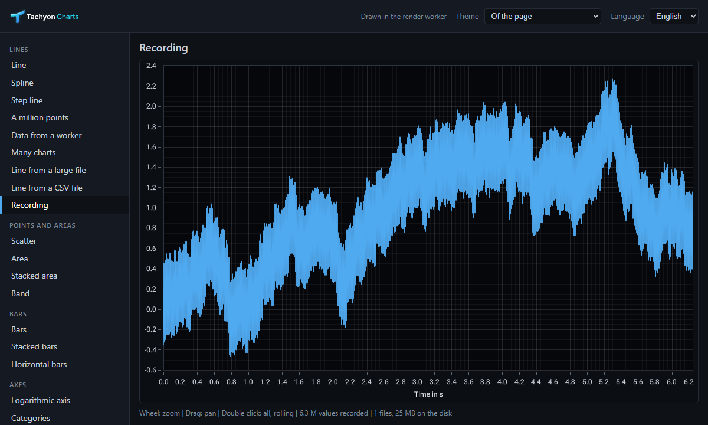
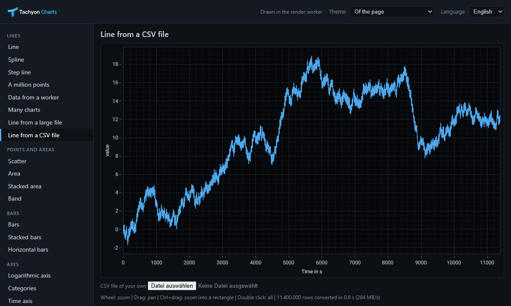

<h1>
  <picture>
    <source media="(prefers-color-scheme: dark)" srcset="shared/logo/tachyon-charts-lockup-dark-transparent.svg">
    
  </picture>
</h1>

**Tachyon Charts for JavaScript**

Fast charts for the browser, drawn on the GPU with WebGPU, with fallbacks to WebGL 2 and Canvas 2D. Made for large
data: millions of points in real time and files larger than memory.

**Status:** early development. Charts with lines, scatter markers, areas, bands and bars draw on WebGPU, with
axes, time axes, layout and text as in the .NET version.
There is no release yet and the API will change. The packages will appear on npm under
`@tachyon-charts/…`.

## A first chart


```ts
import { ChartSurface, DataSource, LineSeries, NumericAxis, TextEngine } from '@tachyon-charts/core';
import { createWebGpuDevice } from '@tachyon-charts/render-webgpu';

const device = await createWebGpuDevice();
const x = new NumericAxis('x', 'bottom');
const y = new NumericAxis('y', 'left');
const chart = new ChartSurface([x], [{ axes: [y] }], new TextEngine(robotoFontData));
chart.addSeries(new LineSeries(source, x, y)); // source: a DataSource with append(x, y)

const target = device.createSurfaceTarget({ kind: 'canvas', canvas }, { width, height }, devicePixelRatio);
chart.render(device, target);
```

A line of a million points draws the extremes of each pixel column, so every peak stays visible; the pyramid behind it
builds in a worker when the data lies in a `SharedArrayBuffer`. Besides `LineSeries` there are `ScatterSeries`,
`AreaSeries`, `StackedAreaSeries`, `BandSeries` and `BarSeries`. The complete example is in `examples/basic`.

The same chart in the words of the .NET version:

```ts
const { surface } = new ChartBuilder()
  .title('Sensors')
  .xAxis((a) => a.title('Time'))
  .yAxis((a) => a.autoRange())
  .addLine(source, (l) => l.stroke(rgba(240, 130, 90)).thickness(2))
  .build(engine);
```

Axes are numeric, logarithmic, categories or time in any time zone, with daylight saving and labels in English or
German. The public API of every package is listed in `docs/api`.

## Web component


`<tachyon-chart>` works in every web application, with any framework or none. It follows its size and the pixel ratio
of the screen, takes zoom, pan, crosshair and keys, follows light and dark of the system, and frees its GPU resources
when it leaves the page:

```html
<tachyon-chart id="chart" style="height: 400px"></tachyon-chart>
<script type="module">
  import { ChartBuilder, DataSource } from '@tachyon-charts/core';
  import { defineTachyonChart } from '@tachyon-charts/element';

  defineTachyonChart();
  const data = new DataSource();
  data.append([0, 1, 2, 3], [1, 3, 2, 4]);
  document.querySelector('#chart').chart = new ChartBuilder().xAxis().yAxis((a) => a.autoRange()).addLine(data);
</script>
```

Attributes: `theme` (`auto`, a built-in name such as `light` or `neon`, or `none`) and `interactive="false"`. Events:
`tachyon-ready`, `tachyon-tooltip` with the point under the pointer, `tachyon-error`. Examples: `examples/web-component`
(a Vite application) and `examples/no-bundler` (an import map, no build step).

Charts draw in a render worker: the element hands its canvas to the worker as `OffscreenCanvas`, and the WebGPU
device there uploads the data, encodes and presents the frames, while the page keeps the chart, its layout and the
input. Where a browser cannot hand a canvas to a worker, charts draw on the main thread; both look the same to the
pixel. `TachyonChartElement.renderInWorker = false` before the first chart chooses the main thread, and
`chart.renderThread` tells where a chart draws. Without the element, `createWebGpuWorkerDevice()` of
`@tachyon-charts/render-webgpu` gives the same device to a chart of your own.

## Performance

Measured with WebGPU in Edge on a laptop GPU, 1920 × 1080, charts drawing in the render worker:

| Scenario | Target | Measured |
|---|---|---|
| Line, 10 million points, zoom and pan | ≥ 60 FPS | 60 FPS |
| Scatter, 10 million points, a color per point | ≥ 60 FPS | 60 FPS |
| Streaming, 10 series × 100 000 points per second | ≥ 60 FPS, no frame > 33 ms | 60 FPS, longest frame 18 ms |
| 50 charts on a page, all streaming | ≥ 45 FPS each | 53 FPS each |
| An idle chart | no frames, < 1 % CPU | no frames, 0.13 % CPU |
| JavaScript of core, render-webgpu and element | < 250 KB compressed | 68 KB gzip |
| First frame after loading the page | < 300 ms | 273 ms |

None of these scenarios has a main-thread task of 50 ms or more. `pnpm bench` measures them again.

## Many charts



All charts of a page share one GPU device, one text engine and one animation frame loop. Each frame, every chart that
changed draws, and in the render worker all their frames go as one message. Charts scrolled out of view pause and draw
what they missed when they return. 50 charts on 1920 × 1080, each streaming 100 000 points per second into a ring of
100 000 points, draw at 60 FPS each. Rings keep the newest points in one piece and summarize their metadata in blocks,
so a frame reads them without a copy.

## Data from workers


A worker can write straight into a chart. On cross-origin isolated pages (`Cross-Origin-Opener-Policy: same-origin`,
`Cross-Origin-Embedder-Policy: require-corp`) a `DataSource` keeps its values in shared memory: the worker writes them
in place and publishes count and metadata with `Atomics`, and a data worker of the page builds the pyramid for
resampling, so the main thread does neither. Elsewhere the worker sends blocks of transferred buffers. Both ways look
the same to the worker:

```ts
// Main thread
const data = new DataSource();
chart.chart = new ChartBuilder().xAxis((a) => a.autoRange()).yAxis((a) => a.autoRange()).addLine(data);
linkDataSource(data, worker, { capacity: 4_000_000 }); // 'shared' or 'transferred'

// Worker
const writer = await acceptDataLink(self);
writer.append(xs, ys);
```

20 million points from a worker through shared memory keep the main thread busy for about 150 ms in all, against about
450 ms when the same points are appended on the main thread. The showroom streams four million points on the page
"Data from a worker".

## Column files

`@tachyon-charts/large-data` reads and writes column files (TCOL), the format of the .NET version for data larger than
memory: both versions read each other's files, and write the same bytes. A file opens from a `File` dropped onto the
page, from the origin private file system (synchronous access in a worker), or from a server with HTTP range requests;
only the pieces read travel.

```ts
import { ColumnFile, ColumnFileWriter, httpSource, MemorySink } from '@tachyon-charts/large-data';

const file = await ColumnFile.open(await httpSource('/data/signal.tcol'));
const values = await file.read(0, 1_000_000, 4096); // column 0, from row 1 000 000, up to 4 096 values

const writer = new ColumnFileWriter(new MemorySink(), { type: 'float32', columns: 2, xStep: 0.001 });
await writer.append(rows); // x0, y0, x1, y1, …
await writer.close();
```

### A line from a file larger than memory


`LargeColumn` opens a column in a worker and builds its pyramid of extremes there, in pieces spread over the whole
file, so the first picture comes at once and refines while the rest is read. `ColumnLineSeries` draws it: from the
pyramid while a pixel column holds many values (a single spike is never lost), exactly from the file when zoomed in,
and from the values themselves at the end, reading ahead to both sides. The finished pyramid is kept in the origin
private file system, so the file opens at once the next time.

```ts
import { ColumnLineSeries, LargeColumn } from '@tachyon-charts/large-data';

const column = await LargeColumn.open({ opfs: 'recordings/run.tcol' }); // or { file } or { url }
chart.chart = new ChartBuilder()
  .xAxis((a) => a.autoRange())
  .yAxis((a) => a.autoRange())
  .addSeries((x, y) => new ColumnLineSeries(column, x, y));
```

A billion float32 values (4 GB) from the origin private file system: first picture after 0.44–0.49 s, the pyramid
complete after 5.5–6.4 s, zoom and pan at 60 FPS, the spike among them kept. The showroom writes a test file of 1 GB
on the page "Line from a large file".

### Digital channels



`DigitalSeries` draws a digital signal as levels and edges, low and high at two values of the Y axis, so that many
channels stand one above the other. Each pixel column asks only for its level and whether it changes, so no edge is
lost, however many points a view holds; narrow views draw every change. Signals come as `DigitalTransitions` (the
places where the level changes), `PackedBits` in memory, or `BitColumn` from a bit column of a column file, whose
index of changes a worker builds while the chart already draws. `BitFileWriter` writes such files, the same bytes as
the .NET version.

```ts
import { DigitalSeries, DigitalTransitions } from '@tachyon-charts/core';
import { BitColumn } from '@tachyon-charts/large-data';

const clock = new DigitalTransitions(0, 1e-9);
clock.append(true, 500); // levels as they come, in runs
const file = await BitColumn.open({ opfs: 'capture/channel0.tcol' });
builder.addSeries((x, y) => Object.assign(new DigitalSeries(file, x, y), { low: 1, high: 1.7 }));
```

### Scatter density from files


`PointTiles` sorts the points of two columns of a column file once into tiles (TPTS, the format of the .NET version,
the same bytes): 1024 × 1024 tiles over the extent, the points of each tile in a random order, and a grid of
4096 × 4096 counts. A worker builds them in bands of tiles that fit in memory, so any number of points works, and
keeps them in the origin private file system. `PointDensitySeries` counts the view per pixel in that worker: a wide
view from the grid, each cell shared out by area, a narrow one from the points of the visible tiles, at most four
million of them, a fair share of each dense tile weighed for the rest. The counts are drawn as a raster on a
logarithmic colormap; zoomed in, single points show. The showroom writes 20 million points on the page
"Scatter density from a file"; their tiles take about 5 s.

```ts
import { Colormap } from '@tachyon-charts/core';
import { PointDensitySeries, PointTiles } from '@tachyon-charts/large-data';

const tiles = await PointTiles.open({ opfs: 'data/points.tcol' }, { xColumn: 0, yColumn: 1 });
builder.addSeries((x, y) => Object.assign(new PointDensitySeries(tiles, x, y), { colormap: Colormap.builtIn('Inferno') }));
```

### Recording for hours



`ColumnRecorder` writes values into column files of fixed size in the origin private file system, one after the
other, as a ring that lets the oldest file go or on and on. It is at once the source and the pyramid of a line over
the recording: memory holds only the extremes of the blocks of the files kept, about 1 % of the values, and the
values come back from the files when a chart zooms in. Each file is a complete column file once full.

```ts
import { ColumnLineSeries, ColumnRecorder } from '@tachyon-charts/large-data';

const recorder = await ColumnRecorder.start({ folder: 'recordings', name: 'run', maxFiles: 8, xStep: 1e-6 });
chart.chart = new ChartBuilder()
  .xAxis((a) => a.autoRange())
  .yAxis((a) => a.autoRange())
  .addSeries((x, y) => new ColumnLineSeries(recorder, x, y));
recorder.append(values); // from the device, as they come
```

A million values per second into a ring of 8 files keeps the memory of the page at 58 MB once the ring is full.

### CSV into column files



`csvToColumnFile` converts a CSV file of numbers into a column file once, as the .NET version does and to the same
values: the file streams in (a `File`, a `Blob` or the body of a fetch), is cut into pieces at line ends and parsed
in parse workers on all cores, and the rows are written in order. The header names the columns; X comes from a column
when it steps evenly, else the rows are numbered. Delimiters, a decimal comma, thousands separators, quotes and
values that are no numbers (they become gaps) are handled.

```ts
import { csvToColumnFile, opfsFile, writableSink } from '@tachyon-charts/large-data';

const target = await opfsFile('data/run.tcol', true);
const summary = await csvToColumnFile(file, writableSink(await target.createWritable()), {
  xColumn: 0,
  onProgress: (share) => (bar.value = share),
});
```

A CSV file of 1 GB converts into the origin private file system in 4.6–4.9 s (about 210 MB/s with 8 workers).

## Interaction


The wheel zooms around the pointer, dragging pans, Ctrl and drag zooms into a rectangle, dragging an axis moves it and
Shift scales it, arrows and + and − move and zoom, Home or a double click shows all data again, Ctrl+Z and Ctrl+Y undo
and redo, and two fingers pan and pinch. A crosshair shows the values of the axes and of all series, a tooltip reports
the nearest point. The interactions are modifiers in a pipeline, the same as in the .NET version, and
`bindChartInput` from `@tachyon-charts/element` feeds them the pointer, wheel and key events of a canvas:

```ts
const pipeline = new ModifierPipeline();
pipeline.interaction = new ChartInteraction(chart);
pipeline.add(new ZoomPanModifier());
pipeline.add(new RubberBandZoomModifier());
pipeline.add(new CrosshairModifier());
bindChartInput(canvas, pipeline);
```

## Themes


Charts take the themes of the .NET version, from the same JSON files: Tachyon Dark and Light, High Contrast, Neon,
Paper, Instrument and Signal, or a theme of your own that changes some values of one of them. `@tachyon-charts/element`
adds light or dark after the preference of the system and themes from CSS custom properties:

```ts
chart.theme = findBuiltInTheme('light');
chart.theme = resolveTheme({ name: 'Mine', base: 'dark', grid: { major: '#FF000080' } });
watchPreferredTheme((theme) => (chart.theme = theme));
chart.theme = themeFromCss(container); // --tachyon-background, --tachyon-grid-major, --tachyon-palette …
```

A chart described with the fluent API brings its own theme with `.theme(findBuiltInTheme('instrument'))`;
`<tachyon-chart>` uses it unless its `theme` attribute names another one.

## Showroom


`examples/showroom` shows every finished feature on a page of its own: lines, splines, step lines, a million points,
scatter, areas, bands, bars, logarithmic, category and time axes, axes in the origin and the themes. A theme and the
language of the axes can be chosen at the top for all pages. Every new feature brings its page.

## Packages

| Package | Content |
|---|---|
| `@tachyon-charts/core` | Charts, axes, data, interaction, layout and themes |
| `@tachyon-charts/render-webgpu` | WebGPU backend |
| `@tachyon-charts/render-webgl` | WebGL 2 fallback |
| `@tachyon-charts/render-canvas` | Canvas 2D fallback and export |
| `@tachyon-charts/element` | The web component `<tachyon-chart>` |
| `@tachyon-charts/large-data` | Column files, pyramids, OPFS, HTTP range requests, workers |
| `@tachyon-charts/3d` | 3D charts |
| `@tachyon-charts/geo` | Maps |
| `@tachyon-charts/medical` | DICOM and NIfTI images |
| `@tachyon-charts/configurator` | The configurator as a web app |

## Documentation

- [File formats](docs/guide/file-formats.md): column files, pyramids, point tiles, rasters and maps

## Build from source

Requires Node.js 22.12 or later. pnpm comes with Node.js through Corepack.

```bash
corepack pnpm install
corepack pnpm build
```

## License

Apache License 2.0, see [LICENSE](LICENSE) and [NOTICE](NOTICE).
