<h1>
  <picture>
    <source media="(prefers-color-scheme: dark)" srcset="shared/logo/tachyon-charts-lockup-dark-transparent.svg">
    
  </picture>
</h1>

**Tachyon Charts for JavaScript**

Fast charts for the browser, drawn on the GPU with WebGPU, with fallbacks to WebGL 2 and Canvas 2D. Made for large
data: millions of points in real time and files larger than memory.

**Status:** early development. Charts with lines, scatter markers, areas, bands, bars, digital channels and rasters
draw on WebGPU, with axes, time axes, layout, text, interaction and themes as in the .NET version, in a render worker
and with data from workers. Column files, rasters and point tiles larger than memory come from the origin private
file system, files or servers.
There is no release yet and the API will change. The packages will appear on npm under
`@tachyon-charts/…`.

## A first chart

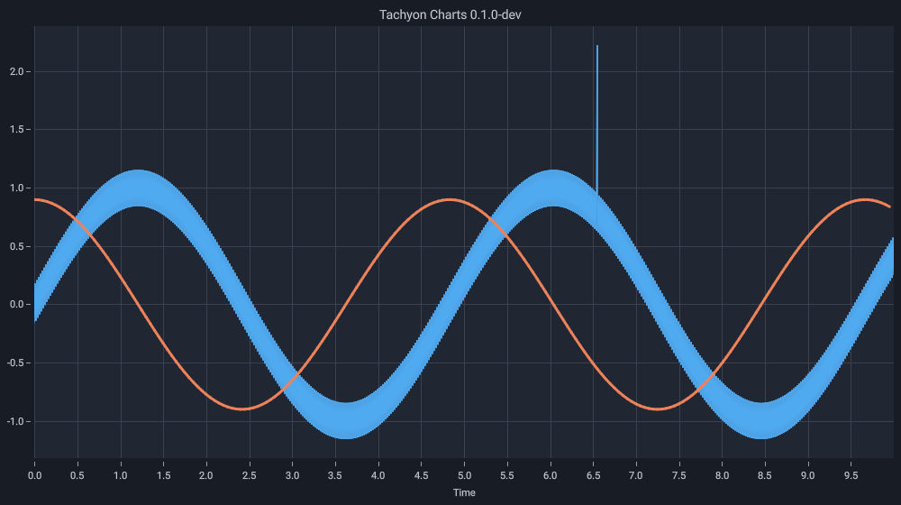

```ts
import { ChartSurface, DataSource, LineSeries, NumericAxis, TextEngine } from '@tachyon-charts/core';
import { createWebGpuDevice } from '@tachyon-charts/render-webgpu';

const device = await createWebGpuDevice();
const x = new NumericAxis('x', 'bottom');
const y = new NumericAxis('y', 'left');
const chart = new ChartSurface([x], [{ axes: [y] }], new TextEngine(robotoFontData));
chart.addSeries(new LineSeries(source, x, y)); // source: a DataSource with append(x, y)

const target = device.createSurfaceTarget({ kind: 'canvas', canvas }, { width, height }, devicePixelRatio);
chart.render(device, target);
```

A line of a million points draws the extremes of each pixel column, so every peak stays visible; the pyramid behind it
builds in a worker when the data lies in a `SharedArrayBuffer`. Besides `LineSeries` there are `ScatterSeries`,
`AreaSeries`, `StackedAreaSeries`, `BandSeries` and `BarSeries`. The complete example is in `examples/basic`.

The same chart in the words of the .NET version:

```ts
const { surface } = new ChartBuilder()
  .title('Sensors')
  .xAxis((a) => a.title('Time'))
  .yAxis((a) => a.autoRange())
  .addLine(source, (l) => l.stroke(rgba(240, 130, 90)).thickness(2))
  .build(engine);
```

Axes are numeric, logarithmic, categories or time in any time zone, with daylight saving and labels in English or
German. The public API of every package is listed in `docs/api`.

## Web component


`<tachyon-chart>` works in every web application, with any framework or none. It follows its size and the pixel ratio
of the screen, takes zoom, pan, crosshair and keys, follows light and dark of the system, and frees its GPU resources
when it leaves the page:

```html
<tachyon-chart id="chart" style="height: 400px"></tachyon-chart>
<script type="module">
  import { ChartBuilder, DataSource } from '@tachyon-charts/core';
  import { defineTachyonChart } from '@tachyon-charts/element';

  defineTachyonChart();
  const data = new DataSource();
  data.append([0, 1, 2, 3], [1, 3, 2, 4]);
  document.querySelector('#chart').chart = new ChartBuilder().xAxis().yAxis((a) => a.autoRange()).addLine(data);
</script>
```

Attributes: `theme` (`auto`, a built-in name such as `light` or `neon`, or `none`) and `interactive="false"`. Events:
`tachyon-ready`, `tachyon-tooltip` with the point under the pointer, `tachyon-error`. Examples: `examples/web-component`
(a Vite application) and `examples/no-bundler` (an import map, no build step).

Charts draw in a render worker: the element hands its canvas to the worker as `OffscreenCanvas`, and the WebGPU
device there uploads the data, encodes and presents the frames, while the page keeps the chart, its layout and the
input. Where a browser cannot hand a canvas to a worker, charts draw on the main thread; both look the same to the
pixel. `TachyonChartElement.renderInWorker = false` before the first chart chooses the main thread, and
`chart.renderThread` tells where a chart draws. Without the element, `createWebGpuWorkerDevice()` of
`@tachyon-charts/render-webgpu` gives the same device to a chart of your own.

## Fallbacks: WebGL 2 and Canvas 2D

Charts run everywhere. The element takes the first renderer that works: WebGPU, then WebGL 2, then Canvas 2D. A
renderer must draw a first frame, and a GPU renderer must take textures of 4096 pixels. When a device is lost, after
a driver reset for example, every chart of the page lets go of it and starts again with a new one; a renderer that
lost its device twice is left out. `TachyonChartElement.renderer` chooses before the first chart: `auto`, `webgpu`,
`webgl2` or `canvas2d`; `chart.renderer` and `chart.rendererName` tell which one draws. The showroom draws with a
fallback on `index.html?renderer=webgl2` or `?renderer=canvas2d`.

### WebGL 2


The same commands and shaders derived line by line from the WGSL shaders. Every scene of the image tests matches the
.NET reference with WebGL 2 within the tolerance of WebGPU, most of them to the pixel. All charts of a page share one
WebGL context, its buffers and the glyph atlas; a frame for a chart goes to its canvas as an image bitmap, without a
copy, in the render worker or on the main thread. Without the element, `createWebGl2Device()` and
`createWebGl2WorkerDevice()` of `@tachyon-charts/render-webgl` give a device of your own.

### Canvas 2D

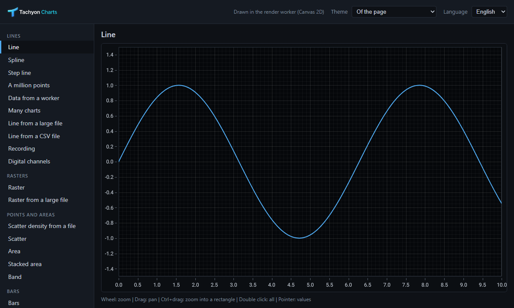

The last fallback, as the Skia backend of the .NET version: buffers and textures in the memory of the CPU, lines as
strokes with round caps and joins, markers as shapes, and on the CPU what the shaders do: distance field text,
rasters through their colormap, triangles with a color per corner and, from 200 000 on, markers written straight into
pixels (a million in about 135 ms). It draws on a canvas of the CPU, where the browser rasterizes with Skia too, so
the scenes match the images of the Skia backend of the .NET version, most of them to the pixel. It draws in the render
worker as well, which keeps the work off the page. `createCanvas2dDevice()` and `createCanvas2dWorkerDevice()` of
`@tachyon-charts/render-canvas` give a device of your own.

## Performance

Measured with WebGPU in Edge on a laptop GPU, 1920 × 1080, charts drawing in the render worker:

| Scenario | Target | Measured |
|---|---|---|
| Line, 10 million points, zoom and pan | ≥ 60 FPS | 60 FPS |
| Scatter, 10 million points, a color per point | ≥ 60 FPS | 60 FPS |
| Streaming, 10 series × 100 000 points per second | ≥ 60 FPS, no frame > 33 ms | 60 FPS, longest frame 18 ms |
| 50 charts on a page, all streaming | ≥ 45 FPS each | 53 FPS each |
| An idle chart | no frames, < 1 % CPU | no frames, 0.13 % CPU |
| JavaScript of core, the renderers and element, fallbacks and export loaded when needed | < 250 KB compressed | 126 KB gzip in all |
| First frame after loading the page | < 300 ms | 292 ms |

With WebGL 2 on the same machine, against the targets of the fallback:

| Scenario | Target | Measured |
|---|---|---|
| Line, 10 million points, zoom and pan | ≥ 30 FPS | 60 FPS |
| Line, a billion values from a column file | first frame < 0.5 s, ≥ 30 FPS | 308 ms, 60 FPS |
| Scatter, 10 million points, a color per point | ≥ 20 FPS | 52 FPS |
| Streaming, 10 series × 100 000 points per second | ≥ 30 FPS | 60 FPS |
| 50 charts on a page, all streaming | ≥ 20 FPS each | 54 FPS each |
| An idle chart | no frames, < 1 % CPU | no frames, 0.12 % CPU |

None of these scenarios has a main-thread task of 50 ms or more. `pnpm bench` measures them again, with WebGPU and
with WebGL 2.

## Many charts


All charts of a page share one GPU device, one text engine and one animation frame loop. Each frame, every chart that
changed draws, and in the render worker all their frames go as one message. Charts scrolled out of view pause and draw
what they missed when they return. 50 charts on 1920 × 1080, each streaming 100 000 points per second into a ring of
100 000 points, draw at 60 FPS each. Rings keep the newest points in one piece and summarize their metadata in blocks,
so a frame reads them without a copy.

## Data from workers

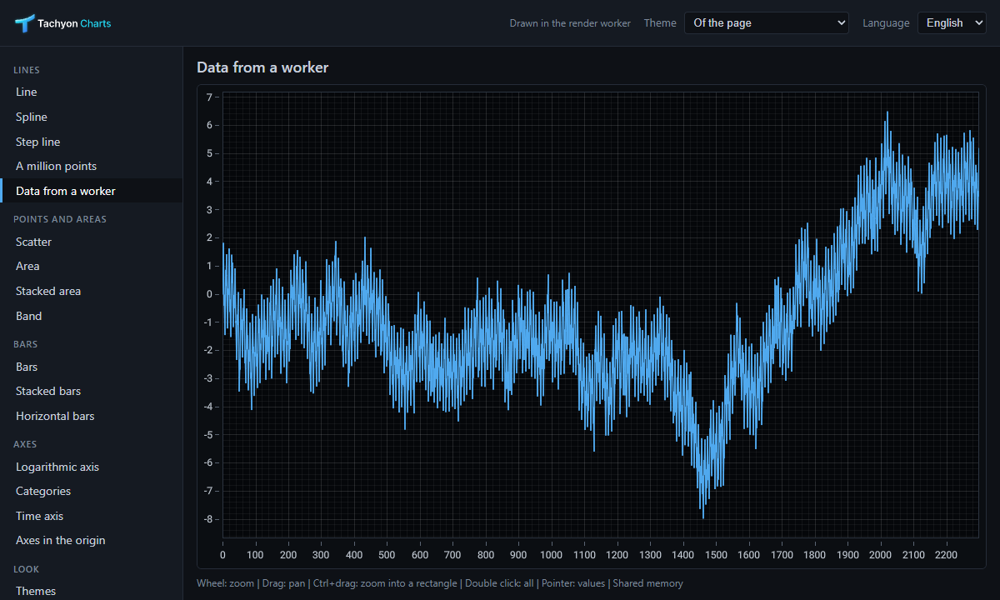

A worker can write straight into a chart. On cross-origin isolated pages (`Cross-Origin-Opener-Policy: same-origin`,
`Cross-Origin-Embedder-Policy: require-corp`) a `DataSource` keeps its values in shared memory: the worker writes them
in place and publishes count and metadata with `Atomics`, and a data worker of the page builds the pyramid for
resampling, so the main thread does neither. Elsewhere the worker sends blocks of transferred buffers. Both ways look
the same to the worker:

```ts
// Main thread
const data = new DataSource();
chart.chart = new ChartBuilder().xAxis((a) => a.autoRange()).yAxis((a) => a.autoRange()).addLine(data);
linkDataSource(data, worker, { capacity: 4_000_000 }); // 'shared' or 'transferred'

// Worker
const writer = await acceptDataLink(self);
writer.append(xs, ys);
```

20 million points from a worker through shared memory keep the main thread busy for about 150 ms in all, against about
450 ms when the same points are appended on the main thread. The showroom streams four million points on the page
"Data from a worker".

## Statistics

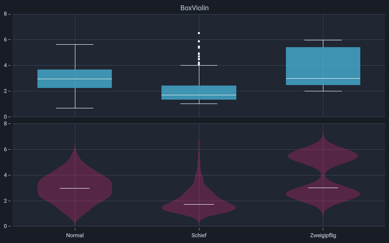

Histograms, box plots and violins as in the .NET version. `computeHistogram` bins values with the rules of NumPy
(a fixed count or width, Sturges, Freedman-Diaconis), and `BarSeries.fromHistogram` draws the bins. `BoxPlotSeries`
shows quartiles, whiskers within 1.5 interquartile ranges and the outliers; `ViolinSeries` the mirrored density of
each sample, a kernel density estimate with the bandwidth of Scott, with a line at the median. Samples stand at the
places of a category axis.

```ts
import { BarSeries, BoxPlotSeries, computeHistogram, ViolinSeries } from '@tachyon-charts/core';

builder.addSeries((x, y) => BarSeries.fromHistogram(computeHistogram(values, 'freedmanDiaconis'), x, y));
builder.addSeries((x, y) => new BoxPlotSeries([first, second, third], x, y));
builder.addSeries((x, y) => new ViolinSeries([first, second, third], x, y));
```

## Error bars and stems

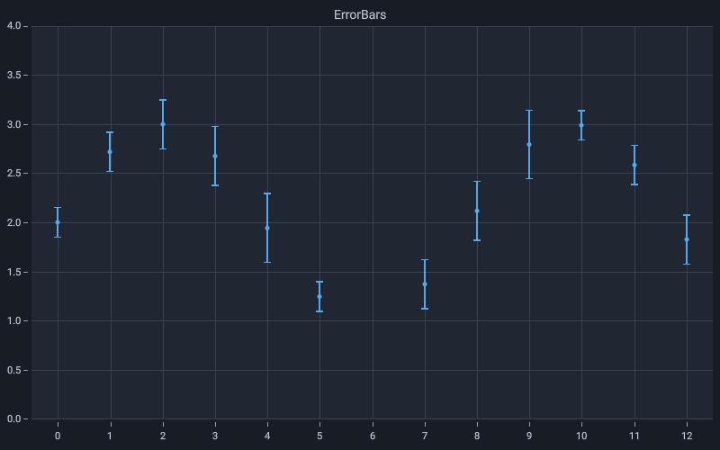

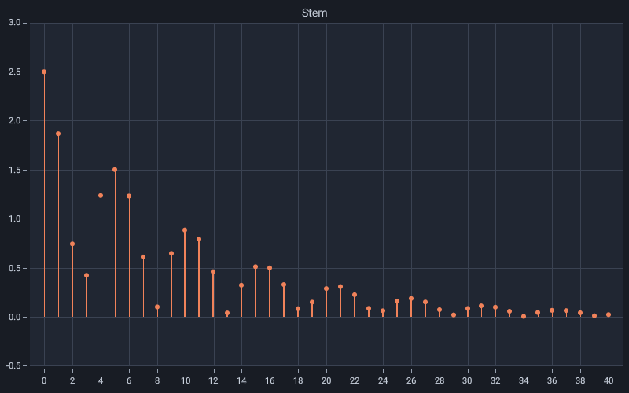

`ErrorBarSeries` shows measured values with their errors below and above: a line with caps and a point at the value;
a missing value leaves a gap. `StemSeries` draws a line from a baseline to each point with a round head, as for the
samples of a signal. Both lie on whole pixels, so all renderers agree.

```ts
import { ErrorBarSeries, StemSeries } from '@tachyon-charts/core';

builder.addSeries((x, y) => new ErrorBarSeries(values, lower, upper, x, y));
builder.addSeries((x, y) => Object.assign(new StemSeries(samples, x, y), { baseline: 0, headSize: 6 }));
```

## Polar and radar charts

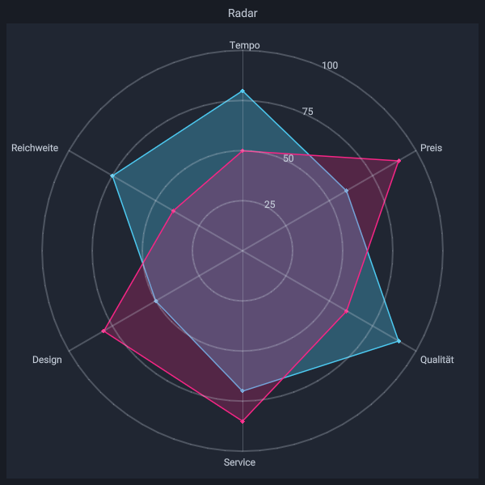

`PolarSeries` draws points by angle and radius, 0 degrees up and clockwise, as an area, a line, markers or all of
them; `PolarSeries.radar` makes a closed polygon with one corner per category. `createPolarChart` sets up hidden axes
for the angle and the radius and a `PolarGridOverlay` of rings and spokes; `RadialZoomModifier` zooms the radius
around the middle.

```ts
import { createPolarChart, DoubleRange, PolarSeries } from '@tachyon-charts/core';

const { chart, angle, radial } = createPolarChart(textEngine, new DoubleRange(0, 100), ['Speed', 'Price', 'Quality']);
chart.addSeries(PolarSeries.radar([80, 60, 90], angle, radial));
```

With a chart builder, `polar`, `smith`, `ternary` and `parallelCoordinates` set up the hidden axes, the grid and the
interactions in one call:

```ts
import { parallelCoordinates, polar, PolarSeries, smith, ternary } from '@tachyon-charts/core';

polar(builder, 100, ['Speed', 'Price', 'Quality'], (x, y) => PolarSeries.radar([80, 60, 90], x, y));
smith(builder, resistance, reactance, 100); // the marker at point 100
ternary(builder, a, b, c, ['Sand', 'Silt', 'Clay']);
parallelCoordinates(builder, columns, ['V', 'A', '°C']);
```

## Smith charts


`SmithSeries` draws impedances, given as resistance and reactance in ohms, at their reflection coefficient relative to
a reference impedance (50 ohms by default). `createSmithChart` sets up hidden axes and a `SmithGridOverlay` of the
circles of constant resistance and the arcs of constant reactance, normalized or in ohms (`showsOhms`).
`SmithMarkerOverlay` marks one point with its impedance, reflection coefficient and standing wave ratio;
`SmithMarkerModifier` moves it to the point next to the pointer while the button is held. With `ChartBuilder`, add the
modifier with `addModifier`: a description with modifiers gets exactly these in the chart element, one without gets the
usual zooming, panning, crosshair and tooltip.

```ts
import { createSmithChart, SmithMarkerOverlay, SmithSeries } from '@tachyon-charts/core';

const { chart, x, y } = createSmithChart(textEngine);
const series = new SmithSeries(resistance, reactance, x, y);
chart.addSeries(series);
chart.addOverlay(new SmithMarkerOverlay(series, 0));
```

## Ternary charts and parallel coordinates


`TernarySeries` places points of three parts, A at the top, B bottom left and C bottom right; the parts need not add
up to 1. `TernaryGridOverlay` draws the triangle with lines every 20 % and the names of the corners.
`ParallelCoordinatesSeries` draws one line per row across one vertical axis per measure, translucent so that the
density shows; `ParallelAxesOverlay` names the axes with their ranges, and `ParallelAxesModifier` moves an axis
dragged at its name, keeps only the rows of a range dragged along an axis and shows all rows again on a double click.

```ts
import { ParallelAxesModifier, ParallelAxesOverlay, ParallelCoordinatesSeries } from '@tachyon-charts/core';

builder
  .xAxis((a) => a.numeric('x').range(0, 1).hidden())
  .yAxis((a) => a.numeric('y').range(0, 1).hidden())
  .addSeries((x, y) => new ParallelCoordinatesSeries(columns, x, y))
  .addOverlay((chart) => new ParallelAxesOverlay(chart.series[0] as ParallelCoordinatesSeries, names))
  .addModifier(() => new ParallelAxesModifier());
```

## Oscilloscope

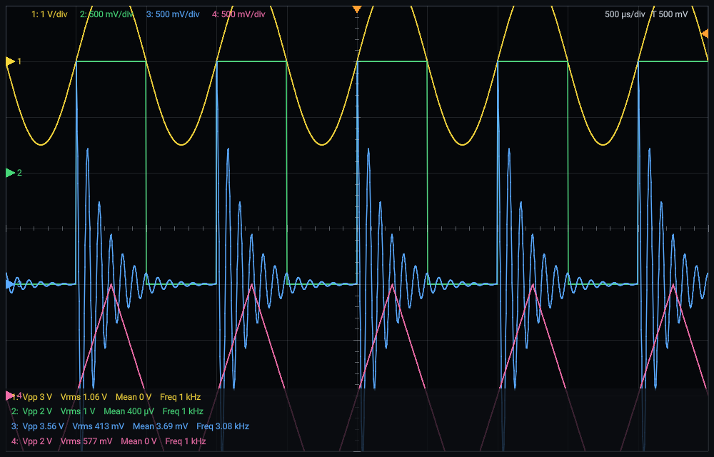

`ScopeDisplay` holds the state of an oscilloscope: channels with volts per division and position, time per division,
time offset, trigger level and persistence (off, variable, infinite or color grade). Each channel measures its
waveform: peak to peak, RMS, mean and frequency. `ScopeTrigger` finds a rising, falling or either edge with
hysteresis in a record of samples, in auto, normal or single mode, and shows the record with the edge at time 0.
`oscilloscope(builder, display)` describes the chart: the graticule with ten by eight divisions, scales and
measurements in the chart language, markers of the channels and the trigger. Dragging at the left moves a channel,
at the right the trigger level, elsewhere the time; the wheel steps the time base 1-2-5, over a scale, at the left
edge or with Ctrl the volts per division.

```ts
import { ChartBuilder, oscilloscope, ScopeDisplay, ScopeTrigger } from '@tachyon-charts/core';

const display = new ScopeDisplay();
display.timePerDivision = 5e-4;
display.addChannel();
const trigger = new ScopeTrigger(display);
element.chart = oscilloscope(new ChartBuilder(), display);
// For every record of samples, one microsecond apart:
trigger.process(1e-6, [samples]);
```

## Spectrum analyzer

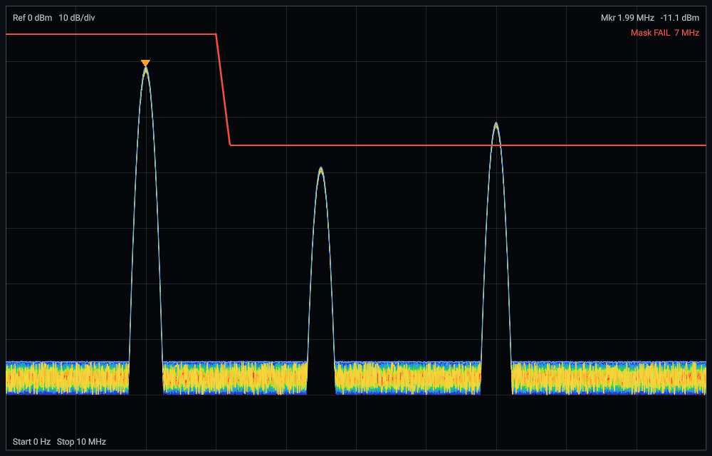

`SpectrumDisplay` holds the state of a spectrum analyzer: span, reference level and dB per division, the trace and
its max hold, the density of all traces so far, the marker on the peak or at a frequency, up to five further markers,
and a `FrequencyMask` whose worst violation it reports. Each trace also goes into a history of 1024 columns by
400 rows. `spectrum(builder, display)` describes the chart with graticule, mask, markers and readouts; the wheel
zooms the frequencies, at the left edge it steps the dB per division and with Ctrl the reference level; dragging
moves the frequencies or, at the mask, the mask; a click sets the marker, Ctrl+click adds or removes one.

```ts
import { ChartBuilder, FrequencyMask, spectrum, SpectrumDisplay } from '@tachyon-charts/core';

const display = new SpectrumDisplay();
display.mask = new FrequencyMask([0, 3e6, 3.2e6, 1e7], [-5, -5, -25, -25]);
display.showsDensity = true;
display.setView(0, 1e7, 0);
element.chart = spectrum(new ChartBuilder(), display);
display.setTrace(frequencies, levels); // for every new trace
```

## Network analyzer

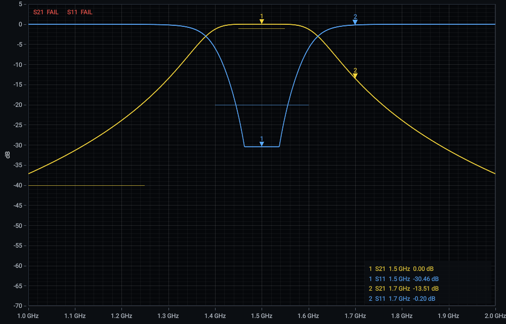

`NetworkDisplay` holds the traces of a network analyzer, such as S21 and S11, as complex responses over frequency,
shown as magnitude in dB or as phase in degrees. Each trace has limit lines, slanted or flat, below or above which it
has to stay, and reports PASS or FAIL; markers read every trace at their frequency. `networkAnalyzer(builder,
display, start, stop, minimum, maximum)` describes the chart with frequency in hertz and the level in dB;
`NetworkMarkerModifier` drags a marker, Ctrl+click adds or removes one.

```ts
import { ChartBuilder, networkAnalyzer, NetworkDisplay, NetworkMarkerModifier, ZoomPanModifier } from '@tachyon-charts/core';

const display = new NetworkDisplay();
const s21 = display.addTrace('S21');
s21.setSweep(frequencies, responses); // responses as { re, im }
s21.addLimit({ kind: 'minimum', startFrequency: 1.45e9, startLevel: -1, stopFrequency: 1.55e9, stopLevel: -1 });
display.addMarker(1.5e9);
element.chart = networkAnalyzer(new ChartBuilder(), display, 1e9, 2e9, -70, 5)
  .addModifier(() => new ZoomPanModifier())
  .addModifier(() => new NetworkMarkerModifier(display));
```

## Sweep and stepping monitors

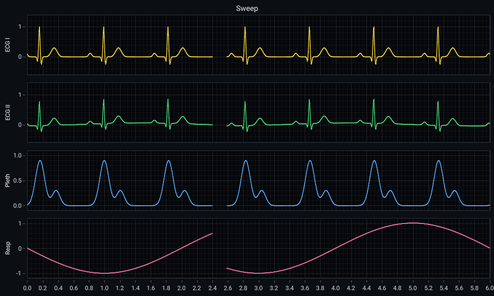

`SweepData` keeps samples of several channels in a ring and shows them in a window of fixed length, as a patient
monitor does: in `sweep` mode the trace writes from the left over the previous page with a small gap ahead of it, in
`stepping` mode the window starts empty when the trace reaches the right edge. `SweepSeries` draws one channel with
the lowest and highest value of each pixel column, so steep edges such as the QRS complex stay whole at any rate.
`sweep(builder, data, ranges, titles)` describes one pane per channel. Series such as these, Smith, ternary and
parallel coordinates take their colors from the palette of the theme.

```ts
import { ChartBuilder, DoubleRange, sweep, SweepData } from '@tachyon-charts/core';

const data = new SweepData(2, 25_000 * 7, 6); // two channels, seven seconds of samples, a window of six
element.chart = sweep(new ChartBuilder(), data, [new DoubleRange(-0.6, 1.4), new DoubleRange(-1, 1)], ['ECG', 'Resp']);
data.append(times, values); // values of all channels, sample after sample
```

## Pie and donut charts

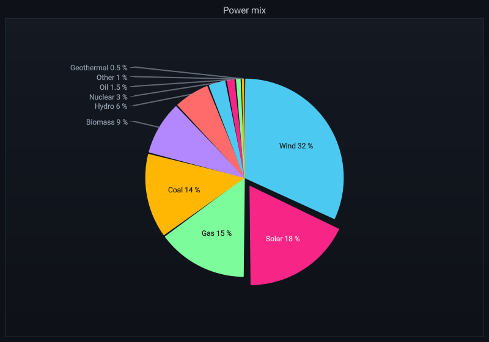

`PieSeries` draws one slice per value from the top clockwise, with a small gap and soft edges; an inner radius makes a
donut. Labels show name and percent, the name, the percent or the value: inside a slice when it is wide enough,
otherwise outside on lines, spread so that they do not overlap. The pointer lights a slice up and shows its value and
share, a click pulls it out and a second click back. The slices take the colors of the theme unless given their own.

```ts
import { ChartBuilder, pie } from '@tachyon-charts/core';

element.chart = pie(new ChartBuilder().title('Power mix'), [32, 18, 15], ['Wind', 'Solar', 'Gas'], (series) => {
  series.innerRadius = 0.55;
});
```

## Candles and OHLC bars

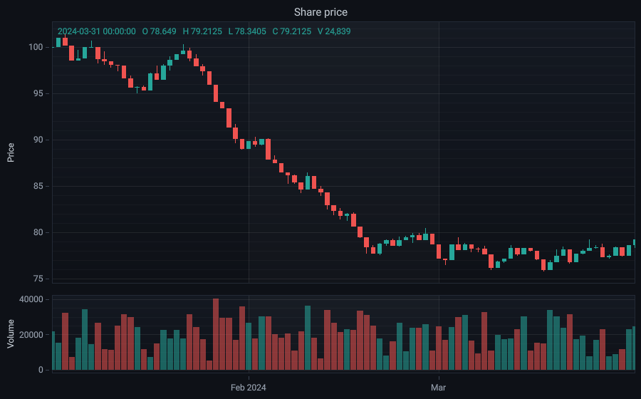

`CandleData` keeps the open, high, low, close and volume of each period in the order of time; the last candle can
change while its period runs (`updateLast`, `addTick`). `CandleSeries` draws them as candles, hollow or filled, or as
OHLC bars; zoomed out, periods narrower than three pixels merge into one column, so the high and the low of every
period stay visible. `VolumeSeries` draws the volume in the colors of the candles. `candles(builder, data)` adds a
readout of the candle under the pointer, or of the last one.

```ts
import { CandleData, candles, ChartBuilder, CrosshairModifier, volume, ZoomPanModifier } from '@tachyon-charts/core';

const data = new CandleData();
data.append(Date.UTC(2024, 0, 2), 100, 101.2, 99.5, 100.8, 18_000);
const builder = new ChartBuilder()
  .xAxis((a) => a.dateTime('time'))
  .yAxis((a) => a.numeric('price').autoRange())
  .yAxis((a) => a.numeric('volume').autoRange().pane(1, 0.3));
candles(builder, data, (series) => (series.style = 'candles'), 'price');
element.chart = volume(builder, data, 'volume')
  .addModifier(() => new ZoomPanModifier())
  .addModifier(() => new CrosshairModifier());
```

## Market profile

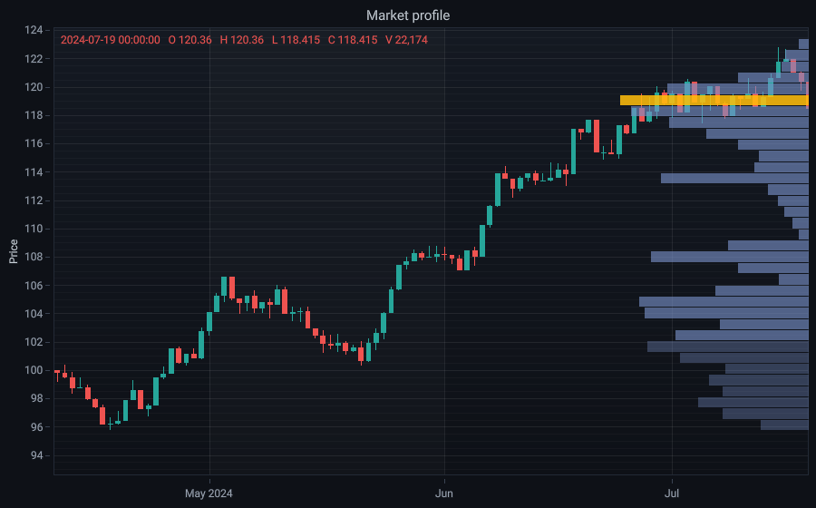

`VolumeProfileSeries` spreads the volume of each visible candle evenly over the price levels from its low to its
high and draws the levels as bars from the side of the plot: the point of control, the level with the most volume,
stands out, the value area around it with 70 % of the volume less. Zooming and panning change the visible candles, and
the profile follows; the pointer on a bar shows its prices, volume and share. `volumeProfile(builder, data, configure,
yAxis)` describes it.

```ts
import { candles, volumeProfile } from '@tachyon-charts/core';

candles(builder, data, undefined, 'price');
volumeProfile(builder, data, (profile) => (profile.levels = 40), 'price');
```

## Axis breaks and time gaps

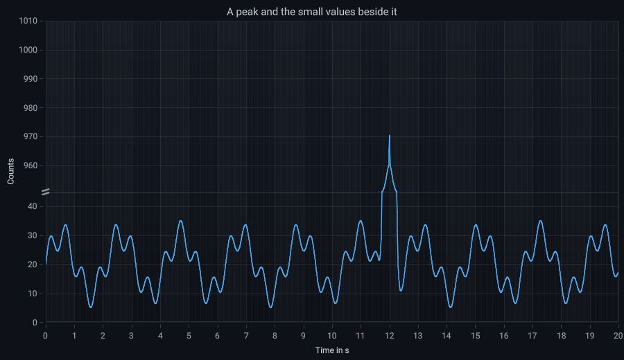

A numeric axis leaves out ranges with `breaks`: a break keeps one hundredth of its length for its mark, the values
after it move up, and no tick lies inside it. A time axis leaves out intervals such as nights or weekends with
`gaps` and a `TimeGapMap`; `TimeGapMap.weekends` builds the weekends of a time zone. Breaks and gaps are marked on the
axis and across the plot; zooming, panning and the values under the pointer go across them.

```ts
import { DoubleRange, TimeGapMap } from '@tachyon-charts/core';

builder.yAxis((a) => a.numeric('y').range(0, 1010).breaks(new DoubleRange(45, 960)));
builder.xAxis((a) => a.dateTime('time').autoRange().gaps(TimeGapMap.weekends(first, last, 'Europe/Berlin')));
```

## Gantt charts

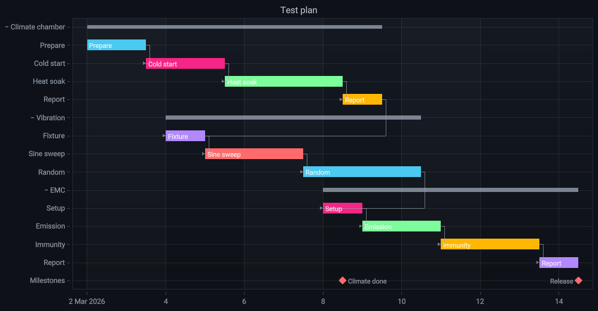

`GanttData` holds rows in groups, tasks from start to end, milestones where start and end are equal, and
dependencies. `GanttSeries` draws the tasks as bars in their rows, each group as a thin bar over its span above its
rows, milestones as diamonds; bars narrower than a pixel merge, so 100 000 tasks stay fast. `gantt(builder, data)` puts
the lines on an inverted category axis and adds the labels inside the bars, the arrows of the dependencies, the start,
end and duration of the task under the pointer, and a click on a group that collapses or opens it.

```ts
import { ChartBuilder, gantt, GanttData, ZoomPanModifier } from '@tachyon-charts/core';

const data = new GanttData();
const row = data.addRow('Cold start', 'Climate chamber');
const first = data.add({ row, start: Date.UTC(2026, 2, 2), end: Date.UTC(2026, 2, 4), label: 'Cold start' });
const builder = new ChartBuilder().xAxis((a) => a.dateTime('time').autoRange());
element.chart = gantt(builder, data).addModifier(() => new ZoomPanModifier());
```

## Polygons and heatmaps in an area

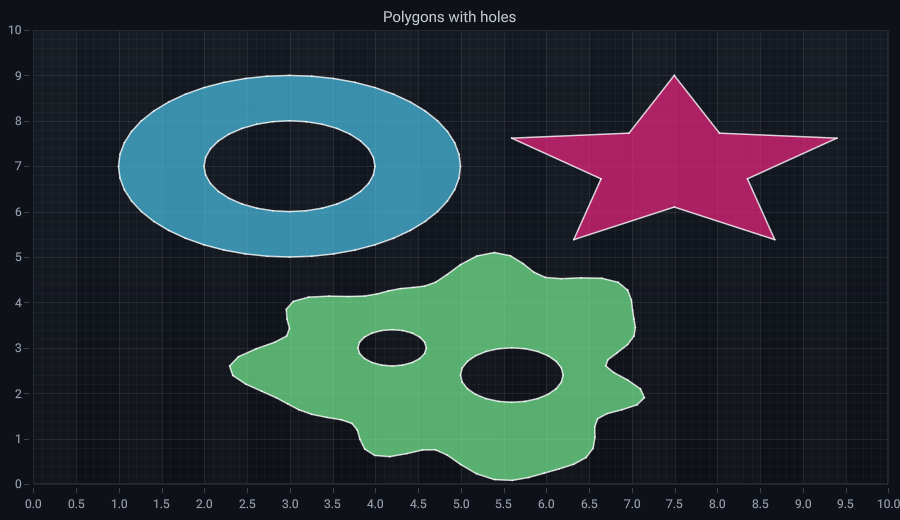

`Polygon` holds an outer `PolygonRing` and holes, with a name and a color of its own if wanted; `contains` tells
whether a point lies inside. `PolygonSeries` fills the polygons in the colors of the palette, cut into triangles with
the holes joined in, and draws their outlines; the pointer finds the polygon under it, 10 000 of them included.
`polygons(builder, shapes, configure)` describes them. A heatmap keeps only the cells inside a `mask` of polygons,
for example a measurement inside a region:

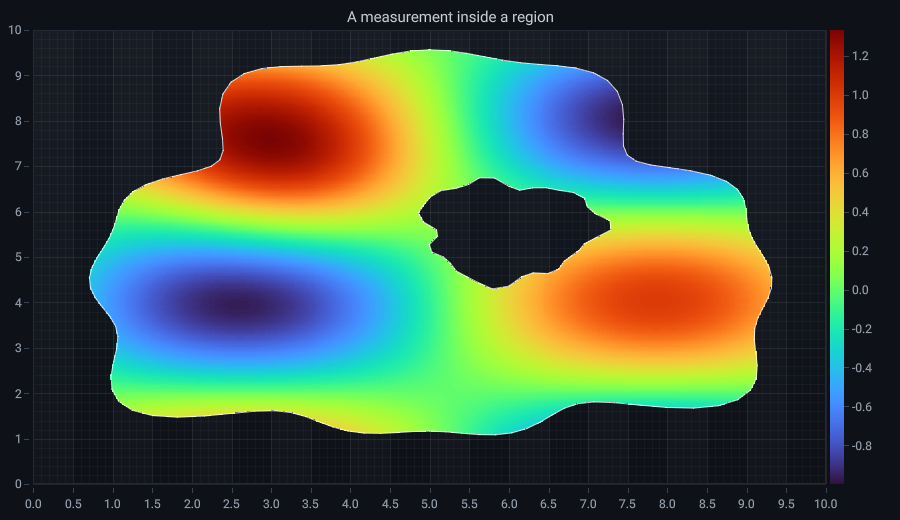

```ts
import { HeatmapSeries, Polygon, PolygonRing, polygons } from '@tachyon-charts/core';

const region = new Polygon(new PolygonRing(outerX, outerY), [new PolygonRing(lakeX, lakeY)], 'Region');
builder.addSeries((x, y, axis) => Object.assign(new HeatmapSeries(data, x, y, axis('color')), { mask: [region] }));
polygons(builder, [region], (series) => (series.fillAlpha = 0));
```

## Maps

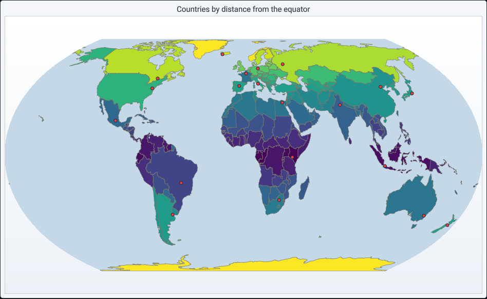

`@tachyon-charts/geo` draws maps without the internet: the countries of the world from Natural Earth (public domain)
come with the package in three levels of detail, and the map takes the finer ones as the view narrows, each read when
it is first needed. `map(builder, projection, configure)` describes the axes over the world and the countries;
`GeoMapSeries` sets the colors of land, sea and borders and of each country by its code (`setColors`), keeps one scale
on both axes and finds the country under the pointer. The projections are `GeoProjection.equirectangular`,
`webMercator` and `equalEarth` (equal areas); data layers go on the same axes, their places projected with
`projectAll`. `ShapefileReader` reads shapefiles with their tables (points, lines, areas), and `GeoMap.fromShapefile`
makes a map of their areas; `GeoMap.save` and `GeoMap.load` keep a map in a compact packed form.

```ts
import { GeoProjection, map } from '@tachyon-charts/geo';

const projection = GeoProjection.equalEarth;
const places = projection.projectAll(longitudes, latitudes);
map(builder, projection, (countries) => countries.setColors({ DEU: green, FRA: blue })).addScatter(points);
```

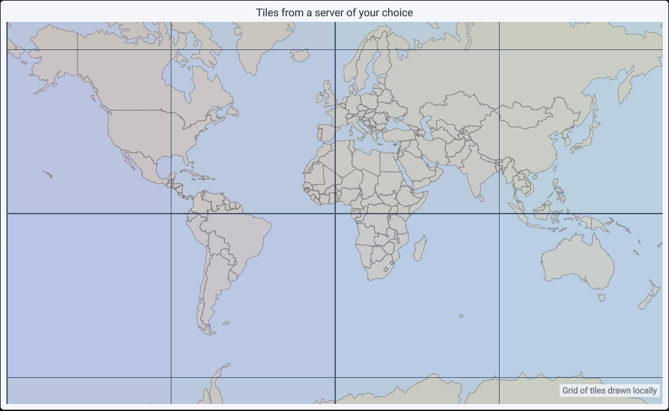

`tiles(builder, source)` puts tiles of a server over a map in Web Mercator, with the notice of their source in the
corner. The library names no server: `new TileSource(address, notice, options)` takes the address with `{z}`, `{x}`
and `{y}` of a server the application may use; `cacheName` keeps tiles in the cache of the browser for the next visit.
Tiles arrive in the background, a coarser one stands in until the finer one is there, and without a network the
countries below show. `TileSource.grid()` draws a grid of tiles without a server.

## Medical images

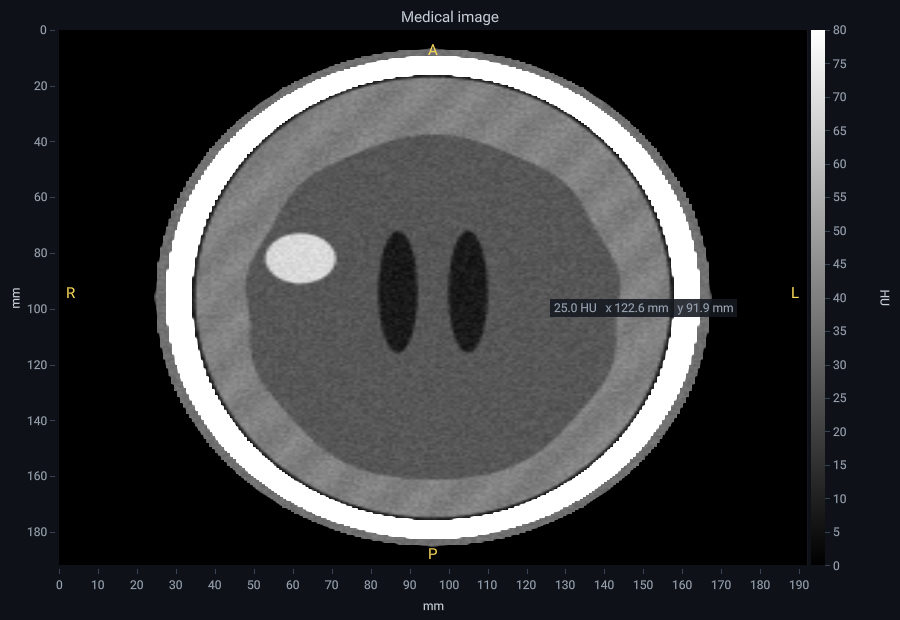

`@tachyon-charts/medical` shows images of scanners in millimetres, without any data about the patient.
`MedicalImageDisplay` takes the values of an image with the spacing of its pixels and its directions in the patient
(`PatientOrientation`), shows them in a window of grey values (`CtWindowPresets.brain`, `bone`, `lung` or
`setWindow`) and marks the directions of the patient at the edges. Dragging with the left button sets window and
level, keys 1 to 3 choose the presets, the colour bar narrows the window under the wheel and moves it when dragged;
the pointer shows the value and the place in millimetres. `MedicalVolume` holds a volume with its voxel spacing,
`MedicalSlices.cut` takes its axial, coronal or sagittal slice through a place, and `MedicalPhantoms` builds a
synthetic head and chest in Hounsfield units for trying things out.

```ts
import { CtWindowPresets, MedicalImageDisplay, MedicalPhantoms, MedicalSlices } from '@tachyon-charts/medical';

const slice = MedicalSlices.cut(MedicalPhantoms.head(), 'axial', new Point3D(0, 0, 97));
const image = new MedicalImageDisplay(slice.values, slice.width, slice.height, slice.spacing, slice.orientation, 'HU');
image.applyPreset(CtWindowPresets.brain);
image.configure(builder);
```

`DicomReader` reads uncompressed DICOM images (implicit and explicit VR, little and big endian, 8 and 16 bits, signed
or not, with their scale); it keeps only the values and the geometry of the image, and skips every other tag, so no
data about the patient is kept or shown, not even in an error. `DicomSeriesReader` stacks the images of a series along
the normal of the slices into a `MedicalVolume`, and `NiftiImageReader` reads `.nii` and `.nii.gz` volumes with their
scale and their geometry from the sform or qform, turned into the directions of DICOM. `MedicalImageDisplay.fromImage`
shows a DICOM image in the window its file suggests. Files are read in the browser and sent nowhere.

```ts
import { DicomSeriesReader, MedicalSlices, NiftiImageReader } from '@tachyon-charts/medical';

const volume = files.length === 1 ? await NiftiImageReader.readFile(files[0]) : await DicomSeriesReader.readFiles(files);
MedicalSlices.display(volume, 'axial', new Point3D(0, 0, 40)).configure(builder);
```

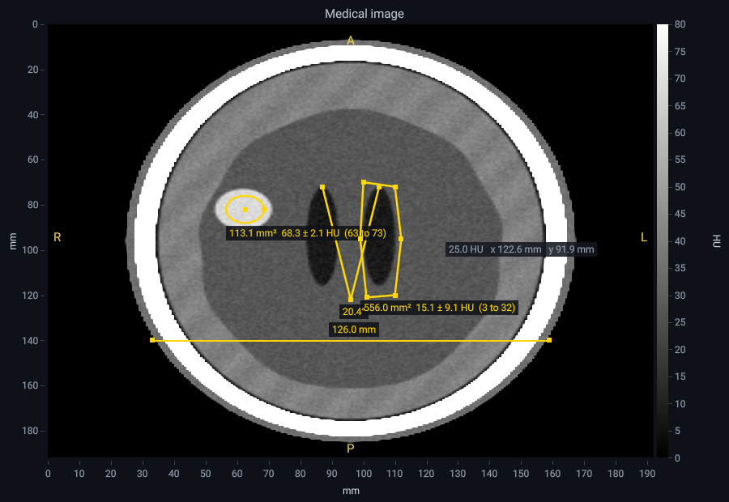

`MedicalImageDisplay.measurements` measures in millimetres, whatever the spacing of the pixels: distances, angles,
circles, rectangles and freehand regions, the regions with their area, circumference and the mean, standard deviation,
lowest and highest value of the pixels whose middles lie inside. Keys D, A, C, R and F or the bar of tools
(`showsTools`) choose a tool, a drag draws, dragging a point changes a measurement, Delete removes it and Ctrl+Z takes
any of it back. `save` and `load` keep the measurements as JSON, `volume(name)` adds up the regions of a name over the
slices. `MedicalProfile` shows the values along a distance and `MedicalHistogram` the values of a region or the whole
slice with the window as a band, each in a chart of its own that follows the measurements.

```ts
const layer = image.measurements;
layer.add('distance', [{ x: 33, y: 140 }, { x: 159, y: 140 }], undefined, 'Width');
const focus = layer.add('circle', [{ x: 62.5, y: 82 }, { x: 68.5, y: 82 }], undefined, 'Focus');
console.log(focus.result.mean, focus.result.standardDeviation);
new MedicalProfile(image).configure(profileBuilder);
```

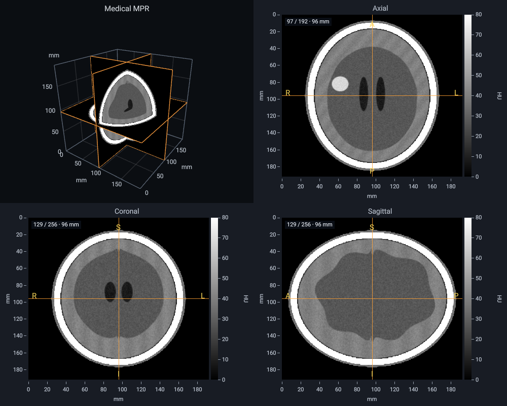

`MedicalMprDisplay` shows a volume in three planes through one place: `axial`, `coronal` and `sagittal` are slices to
put in charts of their own (`configure`), with the place as a cross, the number of the slice and the directions of the
patient, and `configure3D` shows the volume in a 3D chart with the three planes at the place. A click moves the place
and all slices follow, the wheel and the arrow keys step through the slices, dragging sets one window for all, and
each slice measures like a single image; `MedicalProfile` and `MedicalHistogram` follow a slice as well.

```ts
const display = new MedicalMprDisplay(volume);
scene3D(builder, (scene) => display.configure3D(scene));
display.axial.configure(axialBuilder);
display.setPosition(new Point3D(90, 100, 60));
```

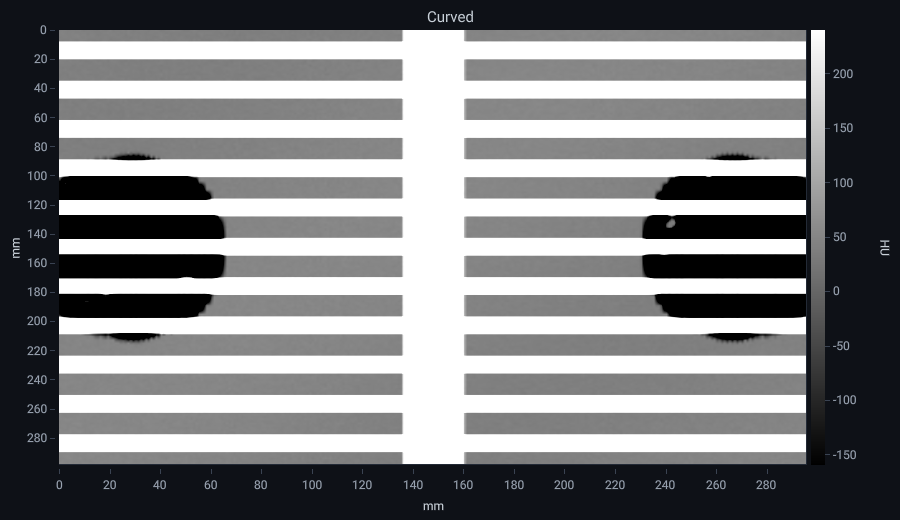

`MedicalObliqueSlice` cuts the volume of a display along a plane in any direction, sampled between the voxels: it can
stand upright on a distance drawn on a slice (`followLine`), move along its normal with the wheel, face the view of a 3D
chart with the key V and show its outline in that chart (`configure3D`). `MedicalCurvedSlice` follows a line, an angle
or a freehand path drawn on a slice down through the whole volume and shows it straightened, such as a section along
the front of the chest.

```ts
const oblique = new MedicalObliqueSlice(display);
oblique.followLine(display.axial);
const curved = new MedicalCurvedSlice(display.axial);
curved.path = display.axial.measurements.add('freehand', arc);
curved.configure(curvedBuilder);
```

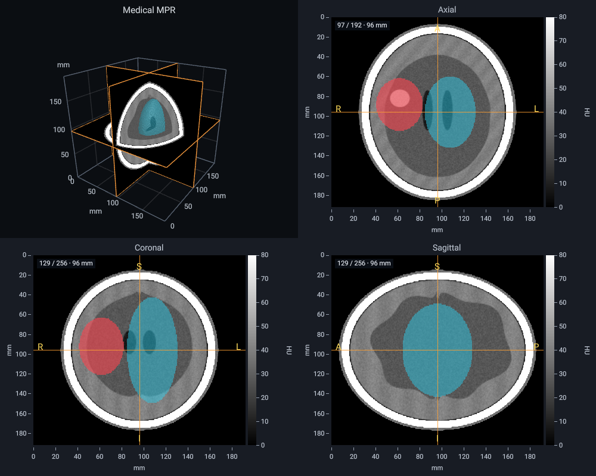

`MedicalSegmentation` holds labels on a raster of its own with its geometry in the patient, and `MedicalSegment`
the name, colour, opacity and visibility of each label. `addSegmentation` puts the labels onto the voxels of the volume
of an MPR display: they show in colour over all slices, and in 3D either as one volume of labels or as a lit surface per
label (`threeDMode`). `NiftiSegmentationReader` reads label maps of NIfTI files.

```ts
const labels = await NiftiSegmentationReader.readFile(file, [new MedicalSegment(1, 'Tumour', red)], 'surface');
display.addSegmentation(labels);
```

The measurements of the three slices show as lines in the 3D chart of the volume, a click on the volume moves the place
of all slices, and `display.cine` plays the slices of a plane as a film (Space in a slice, + and − change the speed).
`DicomSegReader` reads binary DICOM segmentation objects with the names and colours of their segments.

## Legends

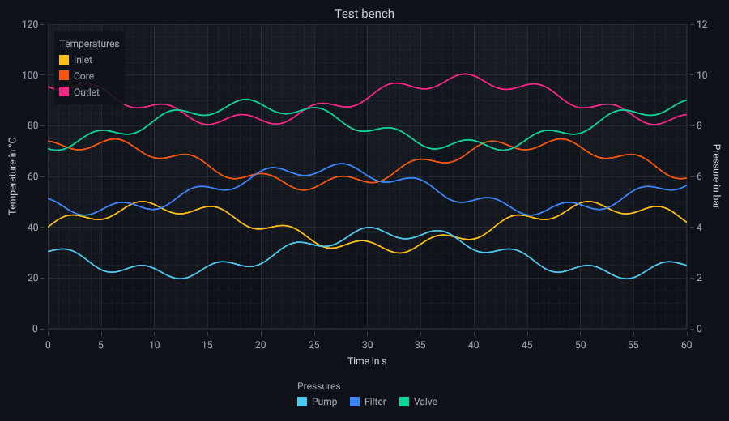

`legend(configure)` adds a legend of all series or of the named ones, with a title if wanted, in a corner of the plot
or beside, above or below it, where it takes room from the plot; a chart can have several. The pointer on a row
highlights its series, a line grows by 1.5 units, and a click switches the series off and on. `LegendModifier` does
this for a chart without a description, and adds a legend in the top right corner if the chart has none.

```ts
builder
  .legend((l) => l.title('Temperatures').series('Inlet', 'Core', 'Outlet').place('topLeft'))
  .legend((l) => l.title('Pressures').series('Pump', 'Filter', 'Valve').place('bottom'));
```

## Annotations

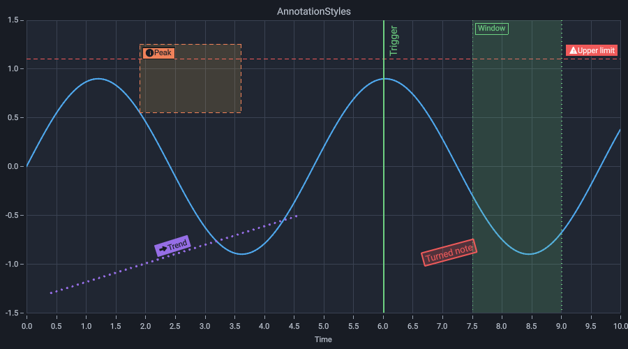

Annotations mark places of the data: `HorizontalLineAnnotation` and `VerticalLineAnnotation` across the plot,
`BandAnnotation` between two values, `BoxAnnotation` between two corners, `TextAnnotation`, `LineAnnotation`,
`ArrowAnnotation`, `MarkerAnnotation` and `ImageAnnotation`. An `appearance` places a label at the start, the middle or
the end, before or after the line, level, along the line or turned by an angle, on a plate of its own color with a
frame and a sign (warning, info, arrow, marker), and draws lines dashed or dotted. With `AnnotationEditModifier`,
editable annotations move and resize with the pointer, Delete removes the chosen one, Ctrl+Z and Ctrl+Y undo and redo.

```ts
import { AnnotationEditModifier, HorizontalLineAnnotation } from '@tachyon-charts/core';

builder
  .addOverlay((chart) =>
    Object.assign(new HorizontalLineAnnotation(chart.panes[0].axes[0]), {
      y: 1.1,
      label: 'Upper limit',
      isEditable: true,
      appearance: { labelPlace: 'end', labelIcon: 'warning', dash: 'dashed' },
    }),
  )
  .addModifier(() => new AnnotationEditModifier());
```

## Drawing tools

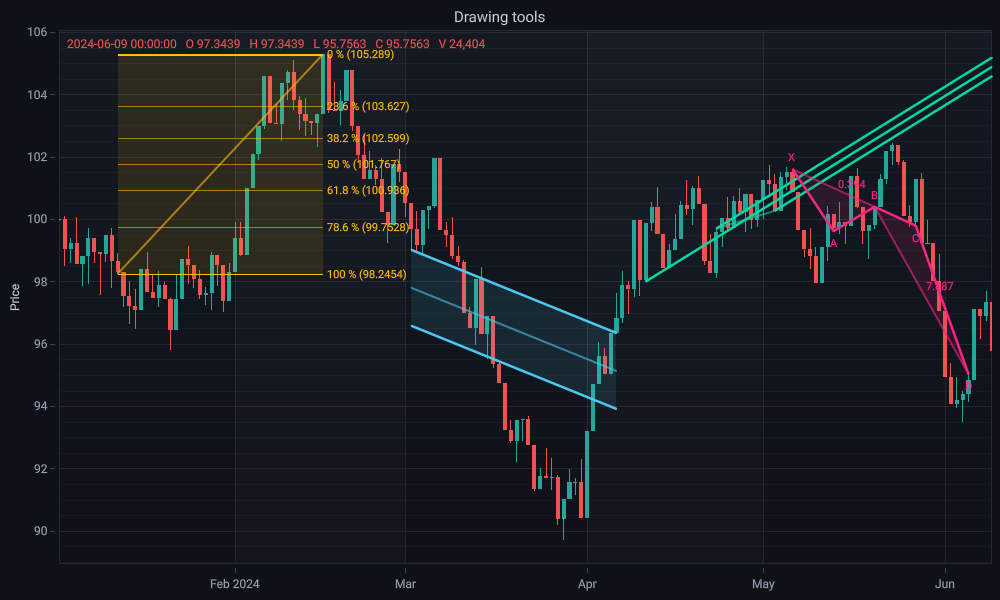

`drawings(builder)` adds a `DrawingLayer` with the tools of technical analysis and the `DrawingModifier` that draws
with them: keys 1 to 9 choose trend line, Fibonacci retracement, Fibonacci extension, trend channel, pitchfork, Elliott
wave, XABCD pattern, head and shoulders and brush; clicks place the points, the brush follows a drag. A drag on a
drawing moves it, on a point of the chosen one moves the point; Delete removes it, Escape or 0 stops the tool, and
every change is a step of the undo chain (Ctrl+Z with `KeyboardNavigationModifier`). `save()` writes the drawings as
JSON and `load()` reads them back, in the same format as the .NET version.

```ts
import { candles, Drawing, drawings, KeyboardNavigationModifier } from '@tachyon-charts/core';

candles(builder, prices);
drawings(builder, (layer) => {
  layer.add(new Drawing('trendLine', [{ x: start, y: 98 }, { x: end, y: 104 }]));
  layer.onCompleted = () => localStorage.setItem('drawings', layer.save());
}).addModifier(() => new KeyboardNavigationModifier());
```

## Rasters and colormaps


`RasterSeries` draws a grid of float values in a colormap: Viridis, Inferno, Magma, Plasma, Turbo and Grayscale, the
same tables as the .NET version. NaN cells stay transparent. The value range is set by the chart, on a linear or a
logarithmic scale; zoomed out, cells are averaged, zoomed in, each cell is a sharp square.

```ts
import { Colormap, DoubleRange, RasterSeries } from '@tachyon-charts/core';

builder.addSeries((x, y) => {
  const series = new RasterSeries(x, y);
  series.colormap = Colormap.builtIn('Inferno');
  series.valueRange = new DoubleRange(-0.5, 1);
  series.setValues(values, 400, 300, { left: -5, right: 5, bottom: -3.75, top: 3.75 });
  return series;
});
```

### Heatmaps and color axes


`HeatmapSeries` shows a grid of values (`HeatmapData`) in the colors of a `ColorAxis`: a color bar beside the plot
with the ticks of the values, which follows the data, can be logarithmic, and has colors for missing values and values
outside its range. Cells have equal steps or edges of their own. With equal cells on linear axes the GPU picks the cells
from one texture of all values, so that zooming and panning upload nothing; other grids and logarithmic axes are
sampled per pixel. Zooming the plot leaves the color axis alone; the wheel over the color bar changes its range.

```ts
import { ColorAxis, HeatmapData, HeatmapSeries } from '@tachyon-charts/core';

const data = new HeatmapData(4096, 4096);
data.setValues(values);
builder
  .yAxis((a) => a.numeric('y'))
  .yAxis((a) => a.color('Inferno', 'values'))
  .addSeries((x, y, axis) => new HeatmapSeries(data, x, y, axis('values') as ColorAxis));
```

### Spectrograms


`SpectrogramSeries` draws a waterfall of rows (`SpectrogramData`, a ring that keeps the newest rows): frequencies along
X, time along Y, the newest row at 0. A new row reaches the GPU as one row of a ring texture, and the shader turns the
ring, so nothing else moves in memory; a pixel over several cells shows their maximum, so that narrow lines stay
visible. 4096 × 4096 cells with a new row every frame draw at 60 FPS while zooming, with WebGPU and with WebGL 2.

```ts
import { ColorAxis, SpectrogramData, SpectrogramSeries } from '@tachyon-charts/core';

const data = new SpectrogramData(4096, 4096);
builder
  .yAxis((a) => a.numeric('y').range(-4096, 0))
  .yAxis((a) => a.color('Plasma', 'values'))
  .addSeries((x, y, axis) => new SpectrogramSeries(data, x, y, axis('values') as ColorAxis));
data.appendRow(spectrum);
```

### Contours

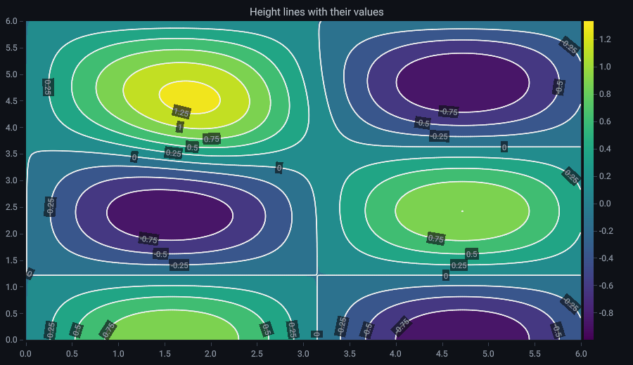

`ContourSeries` draws the isolines of a grid (`HeatmapData`, the samples in the middle of the cells), found with
marching squares as in the .NET version, optionally over filled bands in the colors of its color axis. With
`showsLabels` the lines carry their values: along the line, upright, on a plate that hides the line beneath, at most
one per level and tile of the screen and never on top of each other; zooming and panning move them along.

```ts
import { ColorAxis, ContourSeries } from '@tachyon-charts/core';

builder
  .yAxis((a) => a.color('Viridis', 'values'))
  .addSeries((x, y, axis) =>
    Object.assign(new ContourSeries(data, x, y, axis('values') as ColorAxis), { isFilled: true, showsLabels: true }),
  );
```

## Column files

`@tachyon-charts/large-data` reads and writes column files (TCOL), the format of the .NET version for data larger than
memory: both versions read each other's files, and write the same bytes. A file opens from a `File` dropped onto the
page, from the origin private file system (synchronous access in a worker), or from a server with HTTP range requests;
only the pieces read travel.

```ts
import { ColumnFile, ColumnFileWriter, httpSource, MemorySink } from '@tachyon-charts/large-data';

const file = await ColumnFile.open(await httpSource('/data/signal.tcol'));
const values = await file.read(0, 1_000_000, 4096); // column 0, from row 1 000 000, up to 4 096 values

const writer = new ColumnFileWriter(new MemorySink(), { type: 'float32', columns: 2, xStep: 0.001 });
await writer.append(rows); // x0, y0, x1, y1, …
await writer.close();
```

### A line from a file larger than memory


`LargeColumn` opens a column in a worker and builds its pyramid of extremes there, in pieces spread over the whole
file, so the first picture comes at once and refines while the rest is read. `ColumnLineSeries` draws it: from the
pyramid while a pixel column holds many values (a single spike is never lost), exactly from the file when zoomed in,
and from the values themselves at the end, reading ahead to both sides. The finished pyramid is kept in the origin
private file system, so the file opens at once the next time.

```ts
import { ColumnLineSeries, LargeColumn } from '@tachyon-charts/large-data';

const column = await LargeColumn.open({ opfs: 'recordings/run.tcol' }); // or { file } or { url }
chart.chart = new ChartBuilder()
  .xAxis((a) => a.autoRange())
  .yAxis((a) => a.autoRange())
  .addSeries((x, y) => new ColumnLineSeries(column, x, y));
```

A billion float32 values (4 GB) from the origin private file system: first picture after 0.44–0.49 s, the pyramid
complete after 5.5–6.4 s, zoom and pan at 60 FPS, the spike among them kept. The showroom writes a test file of 1 GB
on the page "Line from a large file".

### Digital channels


`DigitalSeries` draws a digital signal as levels and edges, low and high at two values of the Y axis, so that many
channels stand one above the other. Each pixel column asks only for its level and whether it changes, so no edge is
lost, however many points a view holds; narrow views draw every change. Signals come as `DigitalTransitions` (the
places where the level changes), `PackedBits` in memory, or `BitColumn` from a bit column of a column file, whose
index of changes a worker builds while the chart already draws. `BitFileWriter` writes such files, the same bytes as
the .NET version.

```ts
import { DigitalSeries, DigitalTransitions } from '@tachyon-charts/core';
import { BitColumn } from '@tachyon-charts/large-data';

const clock = new DigitalTransitions(0, 1e-9);
clock.append(true, 500); // levels as they come, in runs
const file = await BitColumn.open({ opfs: 'capture/channel0.tcol' });
builder.addSeries((x, y) => Object.assign(new DigitalSeries(file, x, y), { low: 1, high: 1.7 }));
```

### Scatter density from files

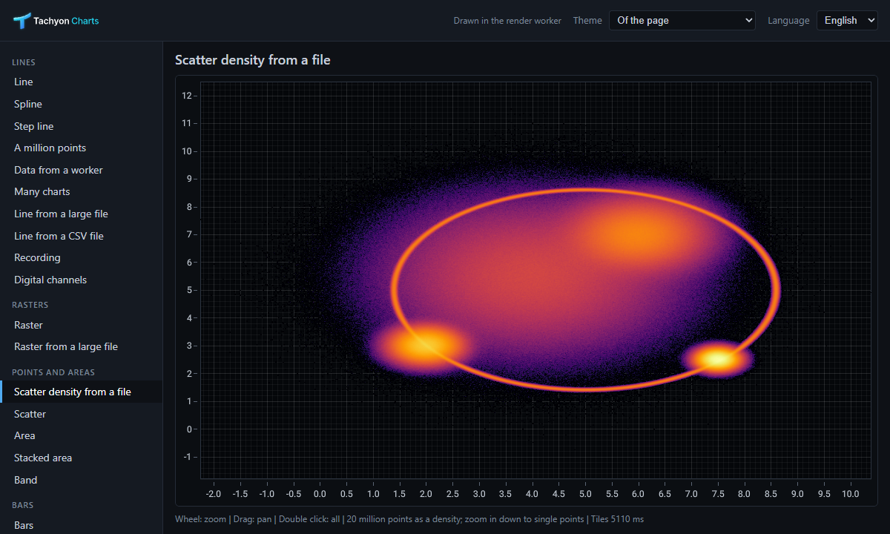

`PointTiles` sorts the points of two columns of a column file once into tiles (TPTS, the format of the .NET version,
the same bytes): 1024 × 1024 tiles over the extent, the points of each tile in a random order, and a grid of
4096 × 4096 counts. A worker builds them in bands of tiles that fit in memory, so any number of points works, and
keeps them in the origin private file system. `PointDensitySeries` counts the view per pixel in that worker: a wide
view from the grid, each cell shared out by area, a narrow one from the points of the visible tiles, at most four
million of them, a fair share of each dense tile weighed for the rest. The counts are drawn as a raster on a
logarithmic colormap; zoomed in, single points show. The showroom writes 20 million points on the page
"Scatter density from a file"; their tiles take about 5 s.

```ts
import { Colormap } from '@tachyon-charts/core';
import { PointDensitySeries, PointTiles } from '@tachyon-charts/large-data';

const tiles = await PointTiles.open({ opfs: 'data/points.tcol' }, { xColumn: 0, yColumn: 1 });
builder.addSeries((x, y) => Object.assign(new PointDensitySeries(tiles, x, y), { colormap: Colormap.builtIn('Inferno') }));
```

### Rasters larger than memory


`RasterFileWriter` writes a raster file (TRAS, the format of the .NET version) row batch by row batch, and
`LargeRaster` opens one from the origin private file system, a File or a server with range requests. A worker builds
its stages once, each half the size of the one below, by mean, maximum or nearest cell, the same bytes as the .NET
version, and keeps them in the origin private file system. `FileRasterSeries` reads only the visible part of the
stage that fits the zoom. The showroom writes 50 million cells (200 MB) on the page "Raster from a large file"; their
stages take about 2 s.

```ts
import { Colormap } from '@tachyon-charts/core';
import { FileRasterSeries, LargeRaster } from '@tachyon-charts/large-data';

const raster = await LargeRaster.open({ opfs: 'data/terrain.tras' });
builder.addSeries((x, y) => Object.assign(new FileRasterSeries(raster, x, y), { colormap: Colormap.builtIn('Turbo') }));
```

### Recording for hours


`ColumnRecorder` writes values into column files of fixed size in the origin private file system, one after the
other, as a ring that lets the oldest file go or on and on. It is at once the source and the pyramid of a line over
the recording: memory holds only the extremes of the blocks of the files kept, about 1 % of the values, and the
values come back from the files when a chart zooms in. Each file is a complete column file once full.

```ts
import { ColumnLineSeries, ColumnRecorder } from '@tachyon-charts/large-data';

const recorder = await ColumnRecorder.start({ folder: 'recordings', name: 'run', maxFiles: 8, xStep: 1e-6 });
chart.chart = new ChartBuilder()
  .xAxis((a) => a.autoRange())
  .yAxis((a) => a.autoRange())
  .addSeries((x, y) => new ColumnLineSeries(recorder, x, y));
recorder.append(values); // from the device, as they come
```

A million values per second into a ring of 8 files keeps the memory of the page at 58 MB once the ring is full.

### CSV into column files


`csvToColumnFile` converts a CSV file of numbers into a column file once, as the .NET version does and to the same
values: the file streams in (a `File`, a `Blob` or the body of a fetch), is cut into pieces at line ends and parsed
in parse workers on all cores, and the rows are written in order. The header names the columns; X comes from a column
when it steps evenly, else the rows are numbered. Delimiters, a decimal comma, thousands separators, quotes and
values that are no numbers (they become gaps) are handled.

```ts
import { csvToColumnFile, opfsFile, writableSink } from '@tachyon-charts/large-data';

const target = await opfsFile('data/run.tcol', true);
const summary = await csvToColumnFile(file, writableSink(await target.createWritable()), {
  xColumn: 0,
  onProgress: (share) => (bar.value = share),
});
```

A CSV file of 1 GB converts into the origin private file system in 4.6–4.9 s (about 210 MB/s with 8 workers).

## Export

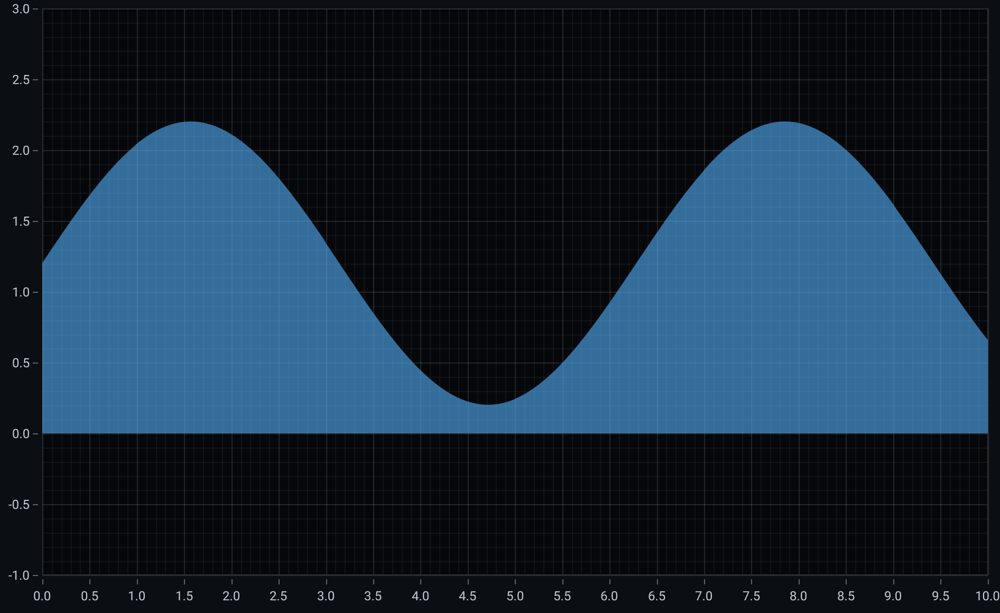

A chart becomes a file as in the .NET version, and the display stays as it is:

- **PNG** with the renderer of the chart, at any size and resolution, with the resolution in the file, so that a
  picture of 300 dpi prints at its size.
- **SVG** with lines, shapes and markers as vectors and text and rasters as pictures of at least 288 dpi.
- **CSV** of the points in the visible ranges: series, X and Y; times as the cursor shows them.
- **Video** as WebM, sharp at its own size (1920 × 1080 and 12 Mbit/s by default, `scale` draws the chart as on a
  scaled screen): the browser encodes each frame at its exact time (VP9, else AV1), so the video plays evenly however
  long a frame takes. A video of fixed length takes `duration`, `step` moves a range or appends data before each
  frame, `onProgress` reports the share done; `startRecording` records the chart as people use it until `stop()`.

```ts
const png = await chart.exportPng({ width: 1200, height: 800, dpi: 300 });
const svg = await chart.exportSvg({ width: 1200, height: 800 });
const csv = await chart.exportCsv();
const video = await chart.recordVideo({ duration: 5, step: (frame, seconds) => moveTo(seconds) });
const recording = await chart.startRecording({ width: 1920, height: 1080 });
// ... people use the chart ...
const recorded = await recording.stop();
```

`chartToPng`, `chartToSvg`, `chartToCsv` and `recordChartVideo` of `@tachyon-charts/render-canvas` do the same for a
chart of your own. The showroom exports the page shown with the buttons in its header.

## Interaction


The wheel zooms around the pointer, dragging pans, Ctrl and drag zooms into a rectangle, dragging an axis moves it and
Shift scales it, arrows and + and − move and zoom, Home or a double click shows all data again, Ctrl+Z and Ctrl+Y undo
and redo, and two fingers pan and pinch. A crosshair shows the values of the axes and of all series, a tooltip reports
the nearest point. The interactions are modifiers in a pipeline, the same as in the .NET version, and
`bindChartInput` from `@tachyon-charts/element` feeds them the pointer, wheel and key events of a canvas:

```ts
const pipeline = new ModifierPipeline();
pipeline.interaction = new ChartInteraction(chart);
pipeline.add(new ZoomPanModifier());
pipeline.add(new RubberBandZoomModifier());
pipeline.add(new CrosshairModifier());
bindChartInput(canvas, pipeline);
```

## Selecting and measuring

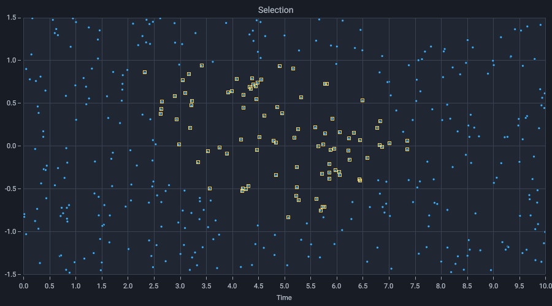
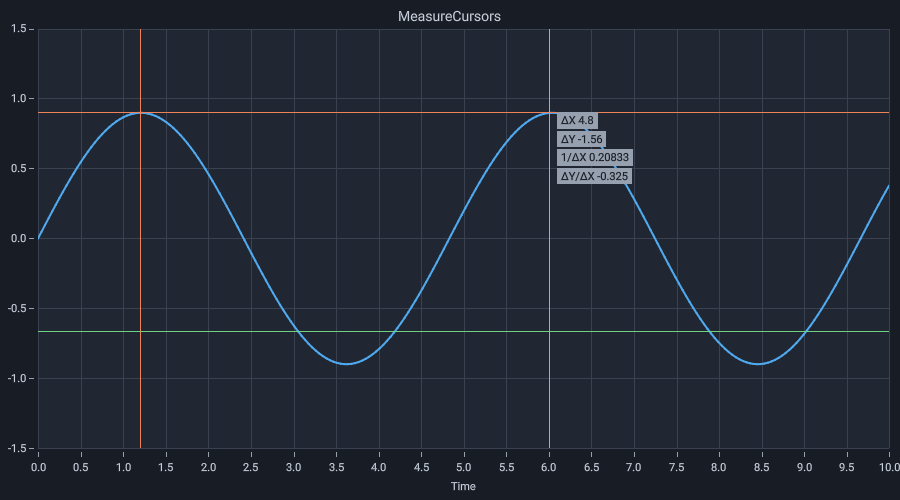

`SelectionModifier` selects points while Shift is held: in a rectangle, in a drawn lasso (`mode = 'lasso'`) or the
nearest one to a click (`'point'`); it marks them and reports them by series and number (`selection`,
`onSelectionChanged`), Escape takes the selection back. `chart.selectPoints(outline)` and `chart.readPoints(selection)`
do the same from code. `MeasureCursorModifier` places two cursors with Alt and a drag and shows ΔX, ΔY, 1/ΔX and the
slope beside them; a drag near a cursor moves it, Escape hides both. While Ctrl and a drag zoom into a rectangle, the
chart shows the rectangle as a preview (`chart.zoomRectangle`).

```ts
const selection = new SelectionModifier();
selection.mode = 'lasso';
selection.onSelectionChanged = (items) => console.log(chart.readPoints(items));
pipeline.add(selection);
pipeline.add(new MeasureCursorModifier());
```

## Chart groups and overview

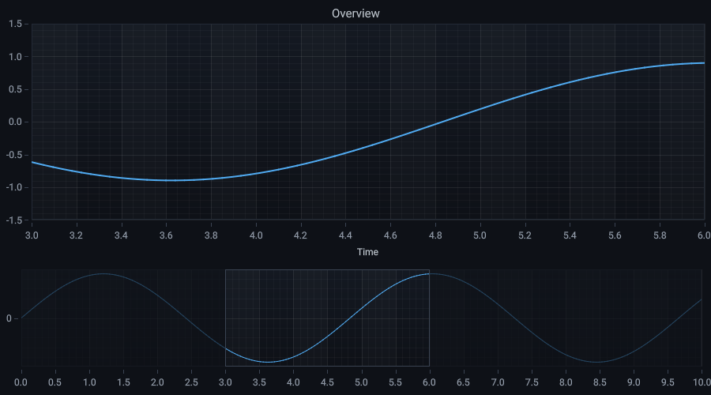

Charts described with the same `group(name)` show the same X range: zooming or panning one moves all, their plots
start and end at the same places however wide the numbers of their axes are, and the crosshair of one draws its line
in all others. An overview chart with `OverviewModifier.of(name)` shades what lies outside the window of the first
chart of the group; dragging the window moves it, dragging an edge scales it, a press beside it centers it there.
`ChartGroup.get(name)` adds and removes charts by hand and reports the crosshair (`onCursorMoved`).

```ts
chart.chart = new ChartBuilder()
  .xAxis((a) => a.numeric('x').range(3, 6))
  .yAxis((a) => a.numeric('y').autoRange())
  .addLine(signal)
  .group('signal');
overview.chart = new ChartBuilder()
  .xAxis((a) => a.numeric('x').autoRange())
  .yAxis((a) => a.numeric('y').autoRange())
  .addLine(signal)
  .addModifier(() => OverviewModifier.of('signal'));
```

## Values at the axis, at points and at the pointer

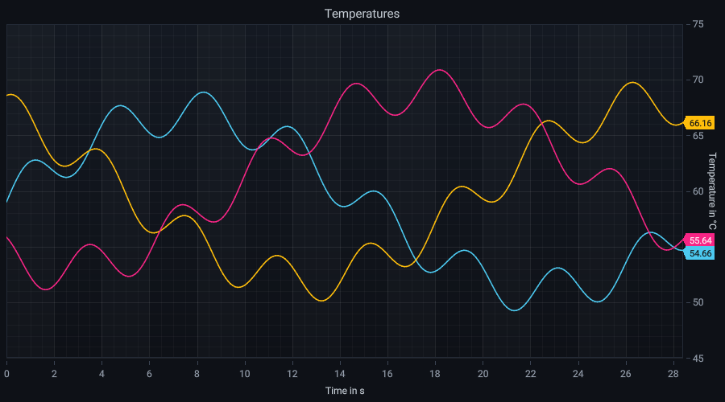
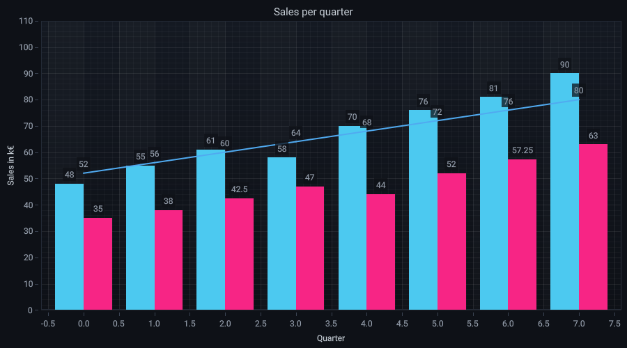
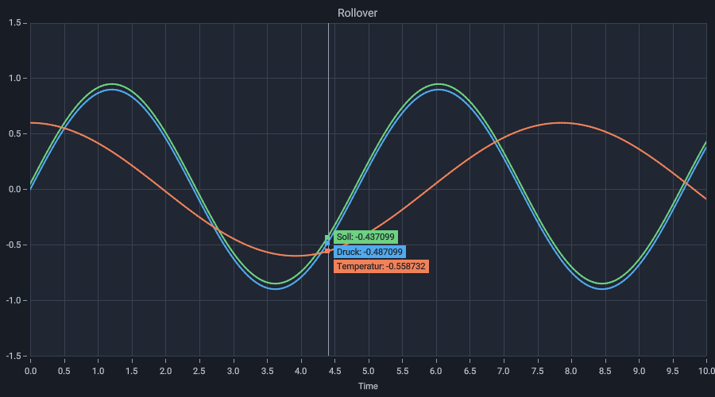

`lastValue()` on a line puts a plate with its newest value at the axis, in the color of the line; plates that meet
move apart and a value outside the view sticks to the edge. `values()` on a line and `showsValues` on any series write
the values beside the points, above grouped bars and in the middle of stacked ones, leaving out labels that would
overlap. `RolloverModifier` draws a line at the pointer with the value of every series there, stacked where they meet;
a `CrosshairModifier` with `showsValues` lists them in a box beside the cross.

```ts
builder
  .addLine(inlet, (s) => s.name('Inlet').lastValue())
  .addLine(target, (s) => s.name('Target').values())
  .addModifier(() => new RolloverModifier());
```

## 3D charts

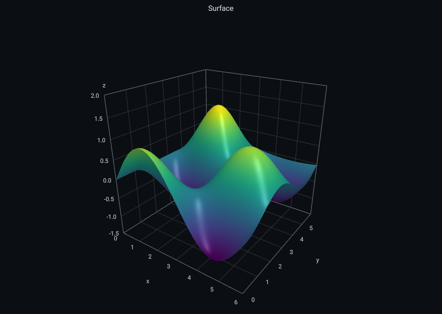
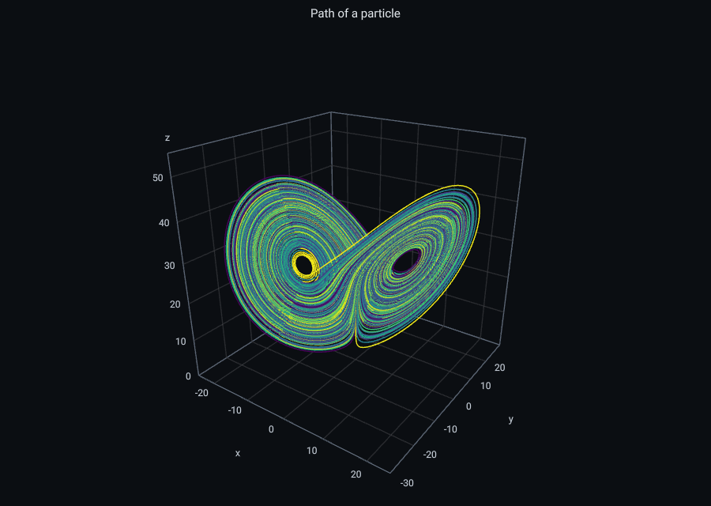
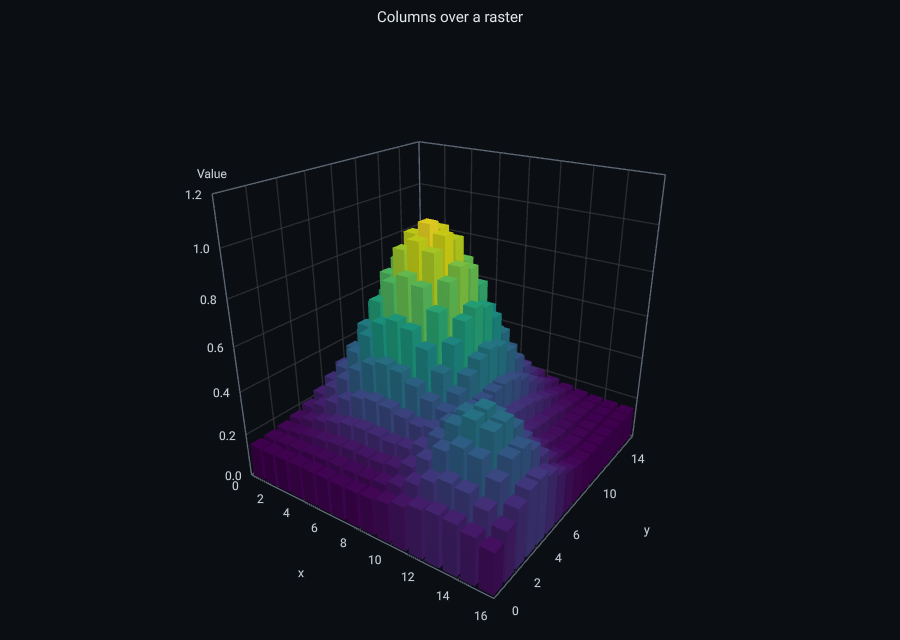
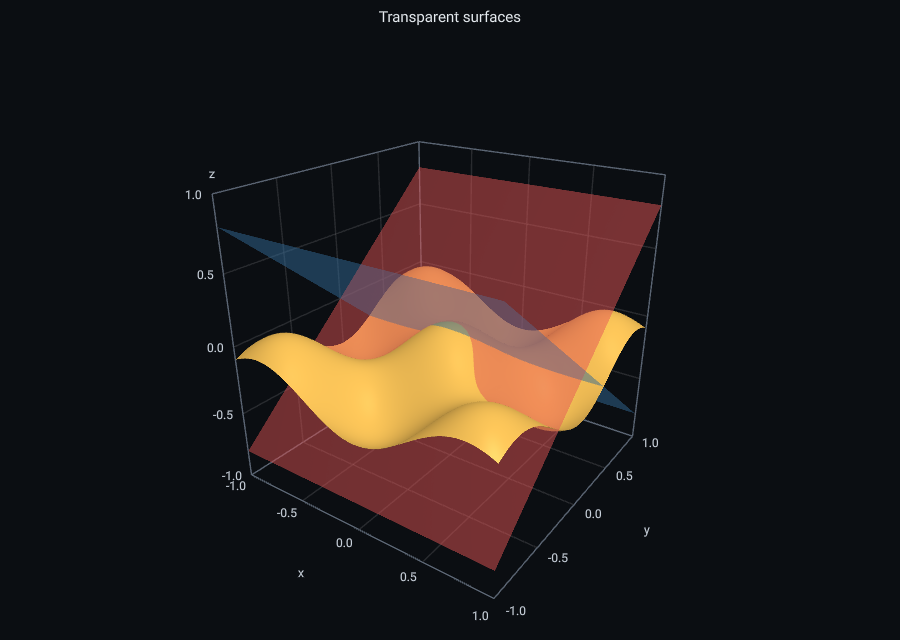
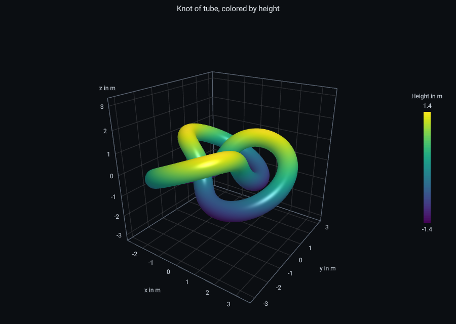
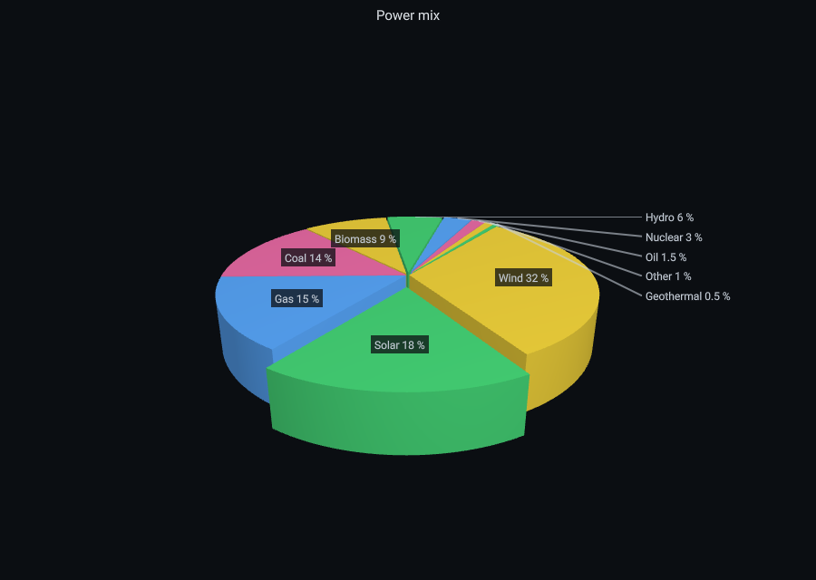
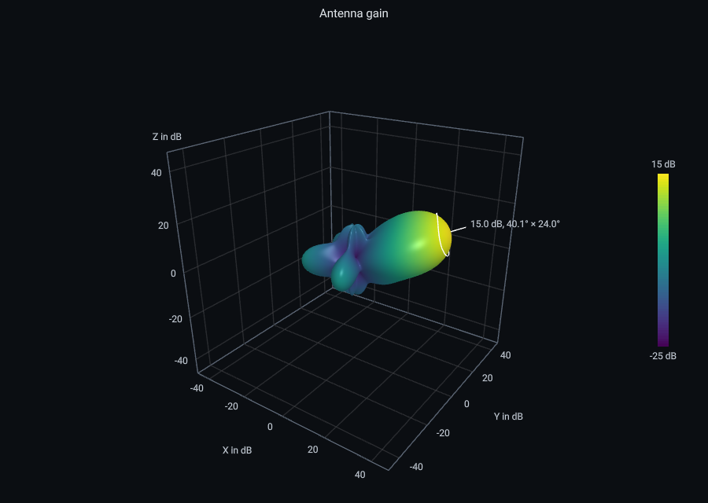
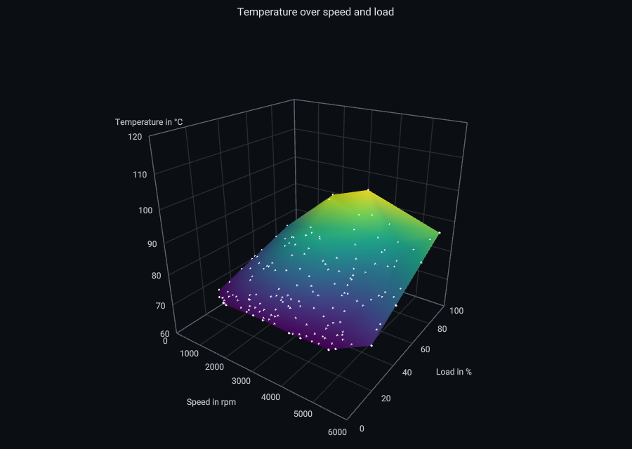
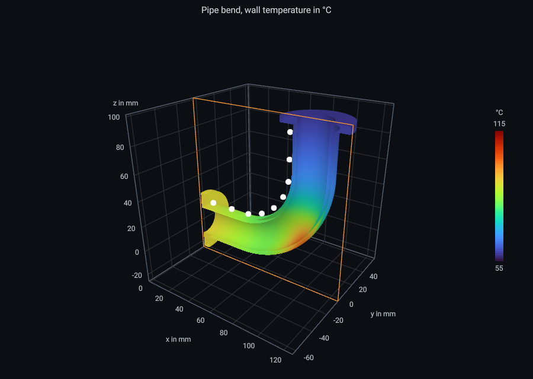
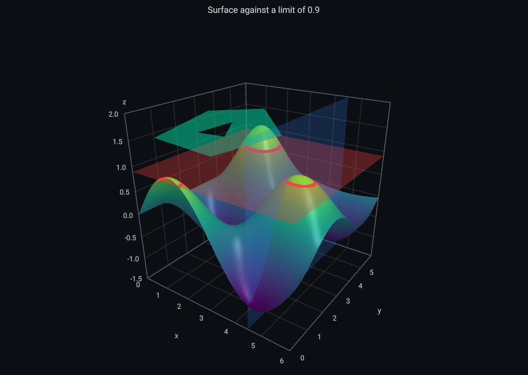
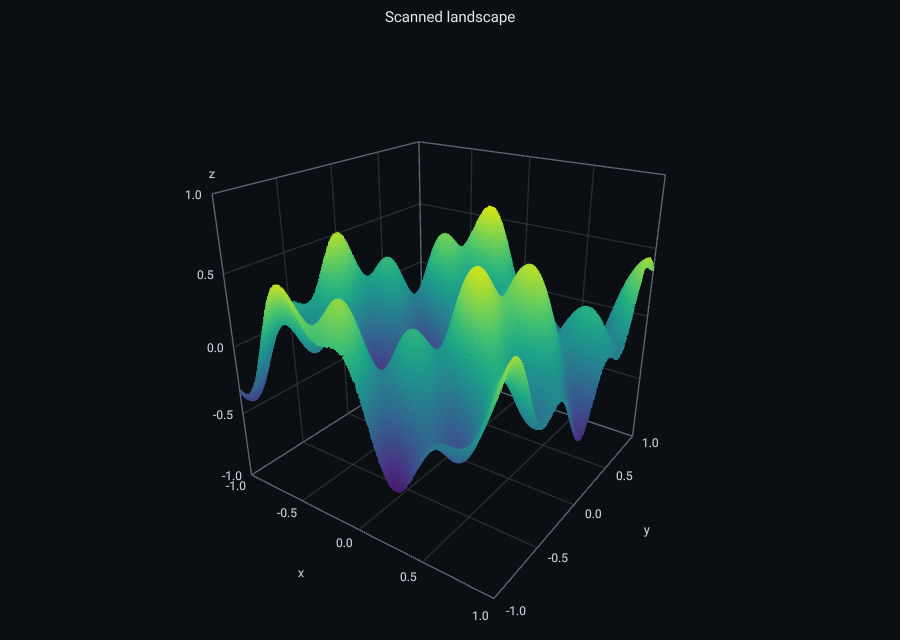
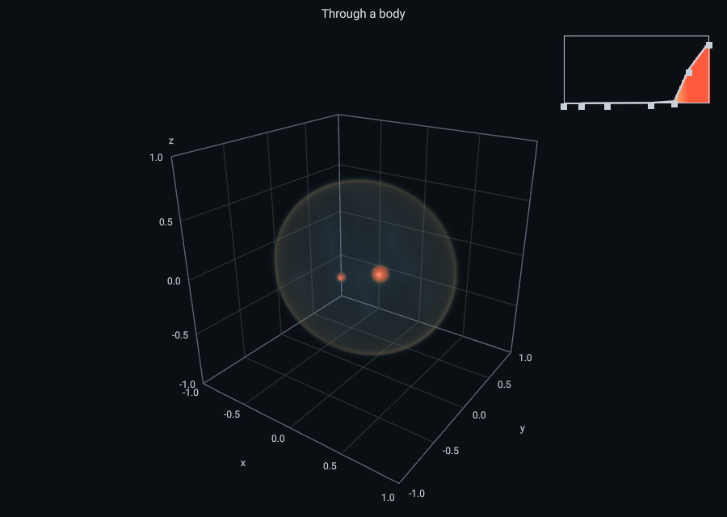
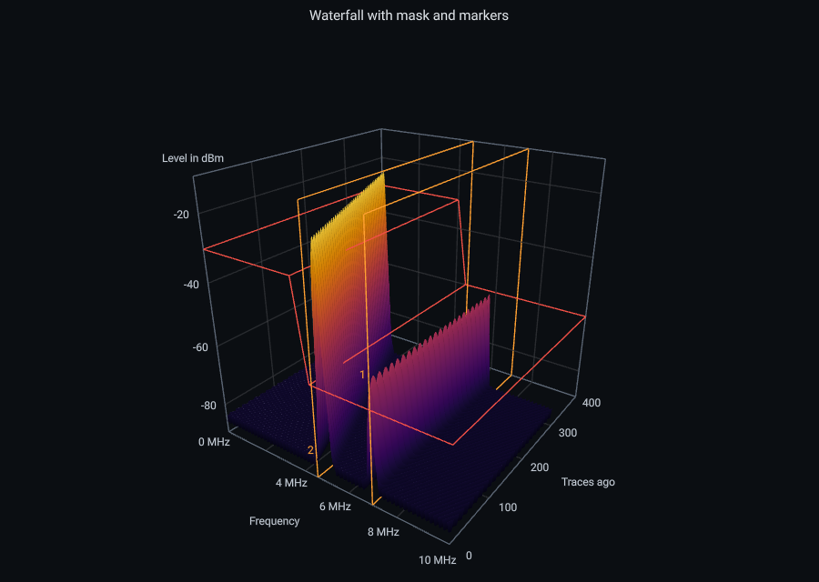

`@tachyon-charts/3d` draws a scene in an axis box: the walls behind the box seen from the eye with their grid, the
numbers and titles of the three axes along the edges, and height fields (`Surface3D`) colored by height and lit, with
gaps where values are missing. A 4096 × 4096 surface keeps its 16.7 million heights in one GPU buffer. Lines through
points in space (`Line3D`) keep their width on the screen, meet without gaps at bends and break at a gap; points in
space (`Scatter3D`) are round spots of their own size and color. Both keep their points in a ring (`Points3D`) that a
live source appends to. Height lines (`Contours3D`) lie on a surface, on the floor and as cuts on the walls;
columns (`Bars3D`) stand over the cells of a grid, colored by value; bubbles (`Bubbles3D`) are lit spheres sized by
value or in pixels. A waterfall (`Waterfall3D`) puts the rows of a spectrogram one behind the other as a
surface or as lines, the newest in front; a new row moves the others back without uploading them again. Meshes (`Mesh3D`) are surfaces from triangles
with a color per corner, flat or lit. Meshes, surfaces and columns with an opacity below 1 let what lies behind shine
through without sorting their triangles (weighted transparency). Models come from STL (text and binary) and OBJ
files (`ModelFile.read`, `readStl`, `readObj`): equal corners are joined, edges where faces meet at more than 40° stay
sharp in the light. `toValueMesh` colors a model by a value per point and shows the color scale beside the box;
`addToScale` gives the three axes the same length so that the model keeps its proportions. A pie or donut
(`Pie3D`, `addPie`) is a lit body with a slice per value, clockwise from the top, one slice pulled out if wanted
(`explodedIndex`); labels sit on wide slices and beside the pie on lines for narrow ones, as on a pie in 2D. The pattern of an antenna (`AntennaPattern3D`, `addAntenna`) is a shape around
the center whose distance is the gain above a floor 40 dB below the peak; the main lobe is marked with its gain and its
widths at half power, and `azimuthCut` and `elevationCut` give cuts for a polar chart. A map from measurements at uneven places
(`MeasuredMap3D`, `addMap`) connects the points to a surface by a Delaunay triangulation in the box, marks the measured
points and can leave out triangles with long edges (`longestEdge`) so that wide gaps stay empty. Up to four planes
(`ClipPlane3D`, `addPlane`) cut away what lies beyond them, for every kind of data; dragging the orange outline of a
plane moves it, and `cutSurface` and `cutBars` give the cut of an upright plane for a 2D chart. Flat shapes (`Shapes3D`) are meshes too: polygons with holes on a plane
in space (`polygon`, `polygonThrough`), rectangles and level planes at a limit (`limit`, see-through by default). Very large clouds of points
(`PointCloud3D`, `addCloud`) take the points or a function that creates or reads them while the chart shows the
progress. Up to a million points show whole in the first picture; a larger cloud shows an even sample at once while a
worker sorts it into an octree, then every frame draws a budget of real points shared out by what each part covers on
the screen (`pointBudget`, 30 million by default), so the density stays the same while turning and at rest. A cloud far larger than memory is sorted once into pages beside its
column file (`buildCloudPagesInWorker` of `@tachyon-charts/large-data`, kept in the origin private file system for the
next visit) and opened as `CloudPages`: a sample of every page stays on the GPU, so the whole cloud shows at once, and
the pages a view needs finer come into a cache on the GPU, the ones longest unused leaving first (`pageMemory`,
`heightColors`). Point files come from XYZ text (with
colors from the first line on), PLY (text or binary in either byte order) and LAS 1.0 to 1.4 (`PointFile.read`,
`readXyz`, `readPly`, `readLas`), read in slices so that a file may be larger than one buffer:

```ts
const cloud = new PointCloud3D((report) => PointFile.read(file, file.name, report));
chart.chart = scene3D(new ChartBuilder(), (s) => s.title('Scan').addCloud(cloud));
```

Volumes (`Volume3D`, `VolumeData` of 8 bits, 16 bits with a scale or 32-bit floats, `addVolume`) show three slices that
move by their outlines, and rays through the volume: through a transfer function (`TransferFunction3D`, its points
dragged in a small editor), the highest value along each ray (`mode: 'maximum'`) or the lit surface where the values
cross a level (`mode: 'surface'`, with a slider). The values reach the GPU slice by slice; a volume larger than its
budget shows with 16-bit floats or every second, third … value (`gpuFit`, `describeGpuFit`). Volume files come from NIfTI-1, also packed
with gzip (`VolumeFile.readNifti`), and raw files with a layout the application gives (`readRaw`: size, type of 8, 16
or 32 bits, byte order, offset, spacing); `addToScale` keeps uneven spacing in true proportion.

A 3D chart joins 2D charts with `group(name)`: the first axis of the box shares its range with their X axes, so
zooming a 2D chart narrows the box, and their crosshair shows as a frame across the box. `Waterfall3D.from(display)`
shows the history of a spectrum display; its mask stands as a red fence across the depth, its markers as orange frames
numbered as in the spectrum, and the box follows its levels.

The pointer shows what lies under it on every kind of data — surfaces, waterfalls, columns, meshes and models, pies,
bubbles, lines, scatters, clouds and volumes — with its place and value, found on the CPU so that no frame waits. A
click sets a numbered marker (`scene.markers`, `onMarkerAdded`), a click on a marker removes it, Delete removes the
newest; a click on a slice of a pie pulls it out or back, and on the waterfall of a spectrum it sets a marker of the
spectrum. Elements with `showsValues` write their values above their points, evenly thinned and never covering each
other. A `CutCurveFeed` keeps a data source on the cut of an upright plane through a surface, so a 2D chart shows the
cut as a line that follows the plane as it is dragged, and markers of the 3D chart sit on it. The CSV export of a 3D
chart writes its scene: one line per point with object, x, y, z and value, for what lies inside the axes. Drag to turn,
Shift and drag to move, wheel and + and − to zoom, arrows to turn, Home or a double click for the first view. The
scene draws with WebGPU directly: the chart element draws a 3D chart on the main thread with a WebGPU device of its own,
also where the page draws its other charts in a render worker (`ChartBuilder.drawsOnMainThread()`); with WebGL 2,
Canvas 2D or in an export the scene draws on a WebGPU device of its own and hands the picture over.

```ts
import { scene3D, Surface3D } from '@tachyon-charts/3d';
import { ChartBuilder, DoubleRange } from '@tachyon-charts/core';

chart.chart = scene3D(new ChartBuilder(), (s) =>
  s
    .title('Surface')
    .xAxis(0, 6, 'x')
    .yAxis(0, 6, 'y')
    .zAxis(-1.5, 2, 'z')
    .addSurface(new Surface3D(heights, new DoubleRange(0, 6), new DoubleRange(0, 6))),
);
```

## Loading progress


While a chart waits for its data, a `LoadingOverlay` says what it waits for in the middle of the plot, with a bar
where the share is known (`show(text, share)`, `hide()`). Series that start coarse and become exact, such as those of
large column files, rasters and point densities, report `refiningProgress`; a `RefiningOverlay` shows the least share
in the corner of the plot until all are exact.

```ts
const loading = new LoadingOverlay();
chart.chart = new ChartBuilder().addOverlay(() => loading);
const column = await LargeColumn.open({ file, onProgress: (share) => loading.show('Opening', share) });
chart.chart = new ChartBuilder()
  .addSeries((x, y) => new ColumnLineSeries(column, x, y))
  .addOverlay((surface) => new RefiningOverlay(surface));
```

## Themes


Charts take the themes of the .NET version, from the same JSON files: Tachyon Dark and Light, High Contrast, Neon,
Paper, Instrument and Signal, or a theme of your own that changes some values of one of them. `@tachyon-charts/element`
adds light or dark after the preference of the system and themes from CSS custom properties:

```ts
chart.theme = findBuiltInTheme('light');
chart.theme = resolveTheme({ name: 'Mine', base: 'dark', grid: { major: '#FF000080' } });
watchPreferredTheme((theme) => (chart.theme = theme));
chart.theme = themeFromCss(container); // --tachyon-background, --tachyon-grid-major, --tachyon-palette …
```

A chart described with the fluent API brings its own theme with `.theme(findBuiltInTheme('instrument'))`;
`<tachyon-chart>` uses it unless its `theme` attribute names another one.

## Showroom


`examples/showroom` shows every finished feature on a page of its own: lines, splines, step lines, a million points,
scatter, areas, bands, bars, logarithmic, category and time axes, axes in the origin, the themes, data from workers,
many charts, files larger than memory, CSV, recording, digital channels, rasters and scatter density. A theme and the
language of the axes can be chosen at the top for all pages. Every new feature brings its page.

## Configurator


`examples/configurator` builds a chart without writing code: choose a template or start a new chart, pick the type of
each series, its sample data and parameters, the interactions and a legend. The code of the chart shows below it in
TypeScript or JavaScript, ready to copy; the preview runs exactly this code, so the copied code draws the same chart.
Descriptions save and open as `.chart.json`, the same format as the configurator of the .NET version.
3D series of a chart share one scene with the camera, the ranges and titles of the box and cut planes; medical
images come with their window, measurements and linked planes; maps with their projection and tiles. Live charts, such as a running oscilloscope, a spectrum analyzer or a patient monitor, take a list as second
argument: `describeChart(builder, running)` puts the functions that stop their data into it.

```ts
import { applyChartSpec, ChartCatalog, chartCode, coreModule, medicalModule, readChartSpec } from '@tachyon-charts/configurator';

const catalog = new ChartCatalog([coreModule, medicalModule]);
const spec = readChartSpec(json);
const code = chartCode(spec, catalog, 'typescript');
await catalog.load(spec); // the packages of the modules the chart needs, such as medical images
element.chart = applyChartSpec(spec, catalog, new ChartBuilder());
```

## Packages

| Package | Content |
|---|---|
| `@tachyon-charts/core` | Charts, axes, data, interaction, layout and themes |
| `@tachyon-charts/render-webgpu` | WebGPU backend |
| `@tachyon-charts/render-webgl` | WebGL 2 fallback, the same images as WebGPU |
| `@tachyon-charts/render-canvas` | Canvas 2D fallback, the images of the Skia backend; export as PNG, SVG, CSV and video |
| `@tachyon-charts/element` | The web component `<tachyon-chart>` |
| `@tachyon-charts/large-data` | Column files, pyramids, OPFS, HTTP range requests, workers |
| `@tachyon-charts/3d` | 3D charts |
| `@tachyon-charts/geo` | Maps: countries of the world, projections, shapefiles, tiles |
| `@tachyon-charts/medical` | Medical images: window and level, slices of volumes, measuring in millimetres |
| `@tachyon-charts/configurator` | The configurator as a web app |

## Documentation

- [File formats](docs/guide/file-formats.md): column files, pyramids, point tiles, rasters and maps

## Build from source

Requires Node.js 22.12 or later. pnpm comes with Node.js through Corepack.

```bash
corepack pnpm install
corepack pnpm build
```

## License

Apache License 2.0, see [LICENSE](LICENSE) and [NOTICE](NOTICE).
